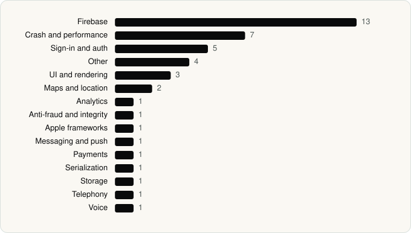

<picture><source media="(prefers-color-scheme: dark)" srcset="../assets/logo/logo-dark.svg"></picture> [Tech Stack](../README.md) / [Companies](README.md) / Anthropic PBC

# Anthropic PBC

The company name is the developer name on the store listing.

**1** apps (1 iOS, 0 Android) · **4** versions · **43** distinct SDKs across their latest versions

<table>
<tr><td align="center" valign="top" width="16%"> <a href="../apps/ios/anthropic-pbc/claude/README.md"><b>Claude by Anthropic</b></a> iOS · 43 SDKs</td></tr>
</table>

## Apps

| | App | Platform | Versions | Latest | Analysed | SDKs | Tracked |
|---|---|---|---|---|---|---|---|
|  | [Claude by Anthropic](../apps/ios/anthropic-pbc/claude/README.md) | iOS | 4 | 1.261021.20 | 2026-10-23 | 43 | Yes |

## SDKs by category

Counted across the latest version of each app.

<picture><source media="(prefers-color-scheme: dark)" srcset="../assets/charts/companies/anthropic-pbc-dark.svg"></picture>

---

Generated by `scripts/build_readme.py` from the JSON files. Do not edit by hand.
