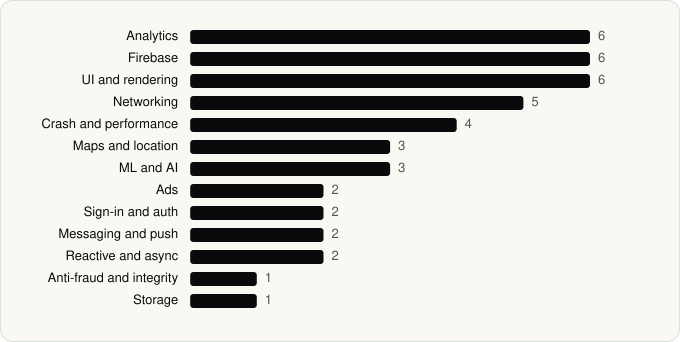

<picture><source media="(prefers-color-scheme: dark)" srcset="../assets/logo/logo-dark.svg"></picture> [Tech Stack](../README.md) / [Companies](README.md) / Capital One Services, LLC

# Capital One Services, LLC

The company name is the developer name on the store listing.

**2** apps (0 iOS, 2 Android) · **2** versions · **28** distinct SDKs across their latest versions

<table>
<tr><td align="center" valign="top" width="16%"> <a href="../apps/android/capital-one-services-llc/capital-one-intellix-mobile/README.md"><b>Capital One Intellix® Mobile</b></a> Android · 17 SDKs</td><td align="center" valign="top" width="16%"> <a href="../apps/android/capital-one-services-llc/capital-one-mobile/README.md"><b>Capital One Mobile</b></a> Android · 26 SDKs</td></tr>
</table>

## Apps

| | App | Platform | Versions | Latest | Analysed | SDKs | Tracked |
|---|---|---|---|---|---|---|---|
|  | [Capital One Intellix® Mobile](../apps/android/capital-one-services-llc/capital-one-intellix-mobile/README.md) | Android | 1 | 1.22.8 | 2026-06-23 | 17 | No |
|  | [Capital One Mobile](../apps/android/capital-one-services-llc/capital-one-mobile/README.md) | Android | 1 | 6.31.10 | 2026-06-19 | 26 | No |

## SDKs by category

Counted across the latest version of each app.

<picture><source media="(prefers-color-scheme: dark)" srcset="../assets/charts/companies/capital-one-services-llc-dark.svg"></picture>

## SDKs shared across their apps

| SDK | Apps |
|---|---|
| Firebase | 2 of 2 |
| Firebase Analytics | 2 of 2 |
| Firebase Crashlytics | 2 of 2 |
| Firebase Messaging | 2 of 2 |
| Google App Measurement | 2 of 2 |
| Google DataTransport | 2 of 2 |
| Google Maps | 2 of 2 |
| Google Mobile Ads (AdMob) | 2 of 2 |
| Google Play services | 2 of 2 |
| Google Sign-In / Auth | 2 of 2 |
| Jetpack Compose | 2 of 2 |
| Kotlin Coroutines | 2 of 2 |
| Material Components | 2 of 2 |
| New Relic | 2 of 2 |
| OkHttp | 2 of 2 |

---

Generated by `scripts/build_readme.py` from the JSON files. Do not edit by hand.
