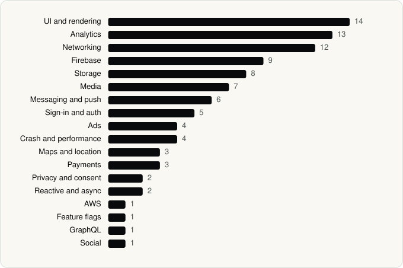

<picture><source media="(prefers-color-scheme: dark)" srcset="../assets/logo/logo-dark.svg"></picture> [Tech Stack](../README.md) / [Companies](README.md) / CBS Interactive, Inc.

# CBS Interactive, Inc.

The company name is the developer name on the store listing.

**3** apps (0 iOS, 3 Android) · **3** versions · **55** distinct SDKs across their latest versions

<table>
<tr><td align="center" valign="top" width="16%"> <a href="../apps/android/cbs-interactive-inc/cbs-sports/README.md"><b>CBS Sports</b></a> Android · 50 SDKs</td><td align="center" valign="top" width="16%"> <a href="../apps/android/cbs-interactive-inc/paramount/README.md"><b>Paramount+</b></a> Android · 25 SDKs</td><td align="center" valign="top" width="16%"> <a href="../apps/android/cbs-interactive-inc/paramount-com-cbs-ott/README.md"><b>Paramount+</b></a> Android · 24 SDKs</td></tr>
</table>

## Apps

| | App | Platform | Versions | Latest | Analysed | SDKs | Tracked |
|---|---|---|---|---|---|---|---|
|  | [CBS Sports: Live Scores & News](../apps/android/cbs-interactive-inc/cbs-sports/README.md) | Android | 1 | 10.72.1 | 2026-06-19 | 50 | No |
|  | [Paramount+](../apps/android/cbs-interactive-inc/paramount/README.md) | Android | 1 | 16.13.0 | 2026-06-23 | 25 | No |
|  | [Paramount+](../apps/android/cbs-interactive-inc/paramount-com-cbs-ott/README.md) | Android | 1 | 16.12.0 | 2026-06-23 | 24 | No |

## SDKs by category

Counted across the latest version of each app.

<picture><source media="(prefers-color-scheme: dark)" srcset="../assets/charts/companies/cbs-interactive-inc-dark.svg"></picture>

## SDKs shared across their apps

| SDK | Apps |
|---|---|
| Adobe Experience Platform | 3 of 3 |
| comScore | 3 of 3 |
| Firebase | 3 of 3 |
| Firebase Messaging | 3 of 3 |
| Glide | 3 of 3 |
| Google Cast | 3 of 3 |
| Google DataTransport | 3 of 3 |
| Google Location | 3 of 3 |
| Google Mobile Ads (AdMob) | 3 of 3 |
| Google Play Billing | 3 of 3 |
| Google Play services | 3 of 3 |
| Google Sign-In / Auth | 3 of 3 |
| Jetpack Compose | 3 of 3 |
| Kochava | 3 of 3 |
| Material Components | 3 of 3 |
| OkHttp | 3 of 3 |
| Okio | 3 of 3 |
| Retrofit | 3 of 3 |
| Room | 3 of 3 |
| Braze | 2 of 3 |

---

Generated by `scripts/build_readme.py` from the JSON files. Do not edit by hand.
