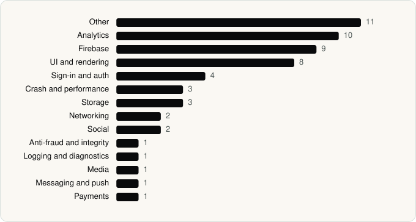

<picture><source media="(prefers-color-scheme: dark)" srcset="../assets/logo/logo-dark.svg"></picture> [Tech Stack](../README.md) / [Companies](README.md) / DealSeek LLC

# DealSeek LLC

The company name is the developer name on the store listing.

**2** apps (1 iOS, 1 Android) · **2** versions · **53** distinct SDKs across their latest versions

<table>
<tr><td align="center" valign="top" width="16%"> <a href="../apps/android/dealseek-llc/dealseek/README.md"><b>DealSeek</b></a> Android · 25 SDKs</td><td align="center" valign="top" width="16%"> <a href="../apps/ios/dealseek-llc/dealseek/README.md"><b>DealSeek</b></a> iOS · 32 SDKs</td></tr>
</table>

## Apps

| | App | Platform | Versions | Latest | Analysed | SDKs | Tracked |
|---|---|---|---|---|---|---|---|
|  | [DealSeek: Coupons & Discounts](../apps/android/dealseek-llc/dealseek/README.md) | Android | 1 | 1.64.0 | 2026-11-02 | 25 | No |
|  | [DealSeek: Coupons & Discounts](../apps/ios/dealseek-llc/dealseek/README.md) | iOS | 1 | 1.64.0 | 2026-11-02 | 32 | No |

## SDKs by category

Counted across the latest version of each app.

<picture><source media="(prefers-color-scheme: dark)" srcset="../assets/charts/companies/dealseek-llc-dark.svg"></picture>

## SDKs shared across their apps

| SDK | Apps |
|---|---|
| Facebook Login | 2 of 2 |
| Facebook SDK | 2 of 2 |
| PostHog | 2 of 2 |
| Sentry | 2 of 2 |

---

Generated by `scripts/build_readme.py` from the JSON files. Do not edit by hand.
