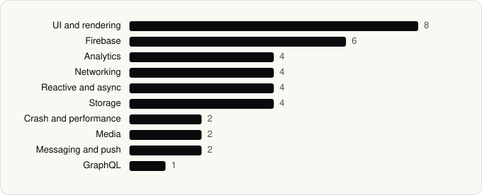

<picture><source media="(prefers-color-scheme: dark)" srcset="../assets/logo/logo-dark.svg"></picture> [Tech Stack](../README.md) / [Companies](README.md) / Deezer Music

# Deezer Music

The company name is the developer name on the store listing.

**2** apps (0 iOS, 2 Android) · **2** versions · **25** distinct SDKs across their latest versions

<table>
<tr><td align="center" valign="top" width="16%"> <a href="../apps/android/deezer-music/deezer-for-creators/README.md"><b>Deezer for Creators</b></a> Android · 15 SDKs</td><td align="center" valign="top" width="16%"> <a href="../apps/android/deezer-music/deezer/README.md"><b>Deezer</b></a> Android · 22 SDKs</td></tr>
</table>

## Apps

| | App | Platform | Versions | Latest | Analysed | SDKs | Tracked |
|---|---|---|---|---|---|---|---|
|  | [Deezer for Creators](../apps/android/deezer-music/deezer-for-creators/README.md) | Android | 1 | 3.0.1 | 2026-06-19 | 15 | No |
|  | [Deezer: Music & Podcast Player](../apps/android/deezer-music/deezer/README.md) | Android | 1 | 1.0.1.1 | 2026-06-19 | 22 | No |

## SDKs by category

Counted across the latest version of each app.

<picture><source media="(prefers-color-scheme: dark)" srcset="../assets/charts/companies/deezer-music-dark.svg"></picture>

## SDKs shared across their apps

| SDK | Apps |
|---|---|
| DataStore | 2 of 2 |
| Firebase | 2 of 2 |
| Firebase Analytics | 2 of 2 |
| Firebase Crashlytics | 2 of 2 |
| Glide | 2 of 2 |
| Google App Measurement | 2 of 2 |
| Google DataTransport | 2 of 2 |
| Google Play services | 2 of 2 |
| Kotlin Coroutines | 2 of 2 |
| Material Components | 2 of 2 |
| OkHttp | 2 of 2 |
| RxJava | 2 of 2 |

---

Generated by `scripts/build_readme.py` from the JSON files. Do not edit by hand.
