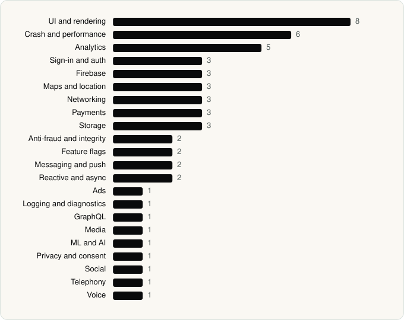

<picture><source media="(prefers-color-scheme: dark)" srcset="../assets/logo/logo-dark.svg"></picture> [Tech Stack](../README.md) / [Companies](README.md) / Deliveroo

# Deliveroo

The company name is the developer name on the store listing.

**2** apps (1 iOS, 1 Android) · **4** versions · **145** distinct SDKs across their latest versions

<table>
<tr><td align="center" valign="top" width="16%"> <a href="../apps/android/deliveroo/deliveroo/README.md"><b>Deliveroo</b></a> Android · 54 SDKs</td><td align="center" valign="top" width="16%"> <a href="../apps/ios/deliveroo/deliveroo/README.md"><b>Deliveroo</b></a> iOS · 98 SDKs</td></tr>
</table>

## Apps

| | App | Platform | Versions | Latest | Analysed | SDKs | Tracked |
|---|---|---|---|---|---|---|---|
|  | [Deliveroo: Food & Shopping](../apps/android/deliveroo/deliveroo/README.md) | Android | 2 | 3.297.2 | 2026-11-09 | 54 | No |
|  | [Deliveroo: Food & Shopping](../apps/ios/deliveroo/deliveroo/README.md) | iOS | 2 | 3.346.0 | 2026-11-01 | 98 | No |

## SDKs by category

Counted across the latest version of each app.

<picture><source media="(prefers-color-scheme: dark)" srcset="../assets/charts/companies/deliveroo-dark.svg"></picture>

## SDKs shared across their apps

| SDK | Apps |
|---|---|
| Adyen | 2 of 2 |
| Braintree | 2 of 2 |
| Firebase | 2 of 2 |
| Google Mobile Ads (AdMob) | 2 of 2 |
| Lottie | 2 of 2 |
| Mapbox | 2 of 2 |
| Stripe | 2 of 2 |

---

Generated by `scripts/build_readme.py` from the JSON files. Do not edit by hand.
