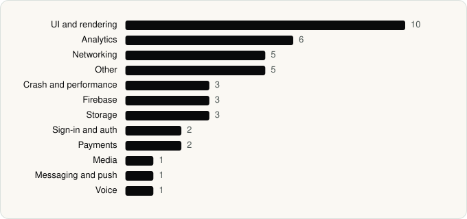

<picture><source media="(prefers-color-scheme: dark)" srcset="../assets/logo/logo-dark.svg"></picture> [Tech Stack](../README.md) / [Companies](README.md) / Discord Inc.

# Discord Inc.

The company name is the developer name on the store listing.

**2** apps (1 iOS, 1 Android) · **4** versions · **39** distinct SDKs across their latest versions

<table>
<tr><td align="center" valign="top" width="16%"> <a href="../apps/android/discord-inc/discord/README.md"><b>Discord</b></a> Android · 27 SDKs</td><td align="center" valign="top" width="16%"> <a href="../apps/ios/discord-inc/discord/README.md"><b>Discord</b></a> iOS · 15 SDKs</td></tr>
</table>

## Apps

| | App | Platform | Versions | Latest | Analysed | SDKs | Tracked |
|---|---|---|---|---|---|---|---|
|  | [Discord - Talk, Play, Hang Out](../apps/android/discord-inc/discord/README.md) | Android | 2 | 352.17 - Stable | 2026-11-10 | 27 | No |
|  | [Discord - Talk, Play, Hang Out](../apps/ios/discord-inc/discord/README.md) | iOS | 2 | 350.0 | 2026-10-23 | 15 | No |

## SDKs by category

Counted across the latest version of each app.

<picture><source media="(prefers-color-scheme: dark)" srcset="../assets/charts/companies/discord-inc-dark.svg"></picture>

## SDKs shared across their apps

| SDK | Apps |
|---|---|
| Amplitude | 2 of 2 |
| React Native Reanimated | 2 of 2 |
| Sentry | 2 of 2 |

---

Generated by `scripts/build_readme.py` from the JSON files. Do not edit by hand.
