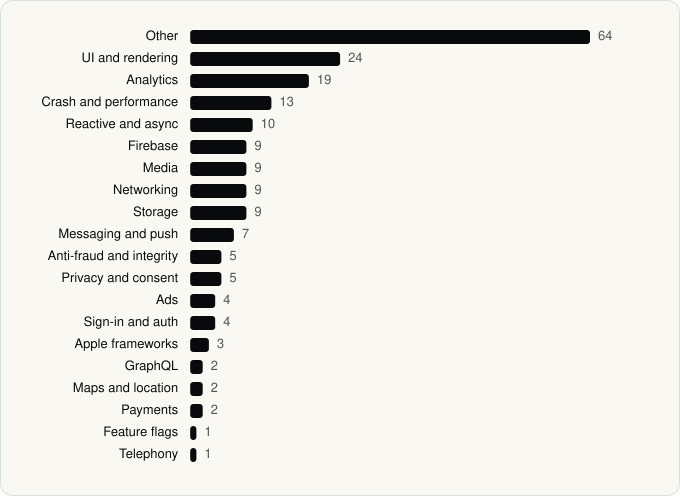

<picture><source media="(prefers-color-scheme: dark)" srcset="../assets/logo/logo-dark.svg"></picture> [Tech Stack](../README.md) / [Companies](README.md) / Disney

# Disney

The company name is the developer name on the store listing.

**5** apps (2 iOS, 3 Android) · **8** versions · **139** distinct SDKs across their latest versions

<table>
<tr><td align="center" valign="top" width="16%"> <a href="../apps/android/disney/disney/README.md"><b>Disney+</b></a> Android · 28 SDKs</td><td align="center" valign="top" width="16%"> <a href="../apps/ios/disney/disney/README.md"><b>Disney+</b></a> iOS · 53 SDKs</td><td align="center" valign="top" width="16%"> <a href="../apps/android/disney/espn-fantasy-sports/README.md"><b>ESPN Fantasy Sports</b></a> Android · 34 SDKs</td><td align="center" valign="top" width="16%"> <a href="../apps/ios/disney/espn/README.md"><b>ESPN</b></a> iOS · 54 SDKs</td><td align="center" valign="top" width="16%"> <a href="../apps/android/disney/hulu/README.md"><b>Hulu</b></a> Android · 33 SDKs</td></tr>
</table>

## Apps

| | App | Platform | Versions | Latest | Analysed | SDKs | Tracked |
|---|---|---|---|---|---|---|---|
|  | [Disney+](../apps/android/disney/disney/README.md) | Android | 1 | 26.9.0+rc2-2026.06.01 | 2026-06-19 | 28 | Yes |
|  | [Disney+](../apps/ios/disney/disney/README.md) | iOS | 2 | 5.20.5 | 2026-11-02 | 53 | Yes |
|  | [ESPN Fantasy Sports](../apps/android/disney/espn-fantasy-sports/README.md) | Android | 2 | 9.12.0 | 2026-11-01 | 34 | Yes |
|  | [ESPN: Live Sports & Scores](../apps/ios/disney/espn/README.md) | iOS | 1 | 8.19.0 | 2026-06-23 | 54 | Yes |
|  | [Hulu: Stream TV shows & movies](../apps/android/disney/hulu/README.md) | Android | 2 | 6.34.0+18552420-google | 2026-11-02 | 33 | Yes |

## SDKs by category

Counted across the latest version of each app.

<picture><source media="(prefers-color-scheme: dark)" srcset="../assets/charts/companies/disney-dark.svg"></picture>

## SDKs shared across their apps

| SDK | Apps |
|---|---|
| Lottie | 5 of 5 |
| Datadog | 3 of 5 |
| Firebase | 3 of 5 |
| Firebase Analytics | 3 of 5 |
| Firebase Messaging | 3 of 5 |
| Glide | 3 of 5 |
| Google Cast | 3 of 5 |
| Google DataTransport | 3 of 5 |
| Google Mobile Ads (AdMob) | 3 of 5 |
| Google Play services | 3 of 5 |
| Google Sign-In / Auth | 3 of 5 |
| Jetpack Compose | 3 of 5 |
| Kotlin Coroutines | 3 of 5 |
| Material Components | 3 of 5 |
| OkHttp | 3 of 5 |
| Okio | 3 of 5 |
| OneTrust | 3 of 5 |
| Room | 3 of 5 |
| RxJava | 3 of 5 |
| AndroidSVG | 2 of 5 |

---

Generated by `scripts/build_readme.py` from the JSON files. Do not edit by hand.
