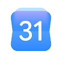
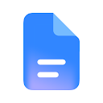
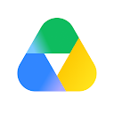
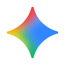
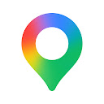
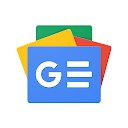
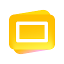
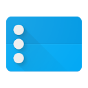
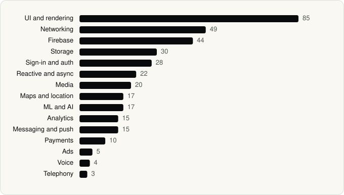

<picture><source media="(prefers-color-scheme: dark)" srcset="../assets/logo/logo-dark.svg"></picture> [Tech Stack](../README.md) / [Companies](README.md) / Google LLC

# Google LLC

The company name is the developer name on the store listing.

**21** apps (0 iOS, 21 Android) · **27** versions · **41** distinct SDKs across their latest versions

<table>
<tr><td align="center" valign="top" width="16%"> <a href="../apps/android/google-llc/gmail/README.md"><b>Gmail</b></a> Android · 21 SDKs</td><td align="center" valign="top" width="16%"> <a href="../apps/android/google-llc/google/README.md"><b>Google</b></a> Android · 27 SDKs</td><td align="center" valign="top" width="16%"> <a href="../apps/android/google-llc/google-calendar/README.md"><b>Google Calendar</b></a> Android · 16 SDKs</td><td align="center" valign="top" width="16%"> <a href="../apps/android/google-llc/google-chat/README.md"><b>Google Chat</b></a> Android · 14 SDKs</td><td align="center" valign="top" width="16%"> <a href="../apps/android/google-llc/google-chrome/README.md"><b>Google Chrome</b></a> Android · 9 SDKs</td><td align="center" valign="top" width="16%"> <a href="../apps/android/google-llc/google-docs/README.md"><b>Google Docs</b></a> Android · 19 SDKs</td></tr>
<tr><td align="center" valign="top" width="16%"> <a href="../apps/android/google-llc/google-drive/README.md"><b>Google Drive</b></a> Android · 21 SDKs</td><td align="center" valign="top" width="16%"> <a href="../apps/android/google-llc/gemini/README.md"><b>Google Gemini</b></a> Android · 5 SDKs</td><td align="center" valign="top" width="16%"> <a href="../apps/android/google-llc/google-keep/README.md"><b>Google Keep</b></a> Android · 13 SDKs</td><td align="center" valign="top" width="16%"> <a href="../apps/android/google-llc/google-lens/README.md"><b>Google Lens</b></a> Android · 8 SDKs</td><td align="center" valign="top" width="16%"> <a href="../apps/android/google-llc/google-maps/README.md"><b>Google Maps</b></a> Android · 22 SDKs</td><td align="center" valign="top" width="16%"> <a href="../apps/android/google-llc/google-meet/README.md"><b>Google Meet</b></a> Android · 17 SDKs</td></tr>
<tr><td align="center" valign="top" width="16%"> <a href="../apps/android/google-llc/google-news/README.md"><b>Google News</b></a> Android · 21 SDKs</td><td align="center" valign="top" width="16%"> <a href="../apps/android/google-llc/google-photos/README.md"><b>Google Photos</b></a> Android · 24 SDKs</td><td align="center" valign="top" width="16%"> <a href="../apps/android/google-llc/google-sheets/README.md"><b>Google Sheets</b></a> Android · 22 SDKs</td><td align="center" valign="top" width="16%"> <a href="../apps/android/google-llc/google-slides/README.md"><b>Google Slides</b></a> Android · 21 SDKs</td><td align="center" valign="top" width="16%"> <a href="../apps/android/google-llc/google-translate/README.md"><b>Google Translate</b></a> Android · 13 SDKs</td><td align="center" valign="top" width="16%"> <a href="../apps/android/google-llc/google-tv-home/README.md"><b>Google TV Home</b></a> Android · 15 SDKs</td></tr>
<tr><td align="center" valign="top" width="16%"> <a href="../apps/android/google-llc/phone-by-google/README.md"><b>Phone by Google</b></a> Android · 15 SDKs</td><td align="center" valign="top" width="16%"> <a href="../apps/android/google-llc/youtube/README.md"><b>YouTube</b></a> Android · 22 SDKs</td><td align="center" valign="top" width="16%"> <a href="../apps/android/google-llc/youtube-music/README.md"><b>YouTube Music</b></a> Android · 19 SDKs</td></tr>
</table>

## Apps

| | App | Platform | Versions | Latest | Analysed | SDKs | Tracked |
|---|---|---|---|---|---|---|---|
|  | [Gmail](../apps/android/google-llc/gmail/README.md) | Android | 2 | 2026.10.19.1005695425.Release | 2026-11-02 | 21 | No |
|  | [Google](../apps/android/google-llc/google/README.md) | Android | 1 | 17.28.32.ve.arm64 | 2026-06-19 | 27 | No |
|  | [Google Calendar](../apps/android/google-llc/google-calendar/README.md) | Android | 1 | 2026.21.0-924344952-release | 2026-06-19 | 16 | No |
|  | [Google Chat](../apps/android/google-llc/google-chat/README.md) | Android | 1 | 2026.05.25.920828381.Release | 2026-06-19 | 14 | No |
|  | [Google Chrome](../apps/android/google-llc/google-chrome/README.md) | Android | 1 | 148.0.7778.217 | 2026-06-23 | 9 | No |
|  | [Google Docs](../apps/android/google-llc/google-docs/README.md) | Android | 2 | 1.26.431.04.90 | 2026-11-02 | 19 | No |
|  | [Google Drive](../apps/android/google-llc/google-drive/README.md) | Android | 2 | 2.26.437.0.all.alldpi | 2026-11-02 | 21 | No |
|  | [Google Gemini](../apps/android/google-llc/gemini/README.md) | Android | 1 | 1.0.995038376 | 2026-10-23 | 5 | Yes |
|  | [Google Keep - Notes and lists](../apps/android/google-llc/google-keep/README.md) | Android | 2 | 5.26.431.02.90 | 2026-11-02 | 13 | No |
|  | [Google Lens](../apps/android/google-llc/google-lens/README.md) | Android | 1 | 1.18.250731009 | 2026-06-19 | 8 | No |
|  | [Google Maps](../apps/android/google-llc/google-maps/README.md) | Android | 1 | 26.22.04.920688788 | 2026-06-19 | 22 | No |
|  | [Google Meet](../apps/android/google-llc/google-meet/README.md) | Android | 1 | 362.0.924540007.duo.android_20260601.01_p0 | 2026-06-19 | 17 | No |
|  | [Google News - Daily Headlines](../apps/android/google-llc/google-news/README.md) | Android | 1 | 5.159.0.914722252 | 2026-06-19 | 21 | No |
|  | [Google Photos](../apps/android/google-llc/google-photos/README.md) | Android | 2 | 7.99.0.1007655401 | 2026-11-02 | 24 | No |
|  | [Google Sheets](../apps/android/google-llc/google-sheets/README.md) | Android | 1 | 1.26.222.02.90 | 2026-06-19 | 22 | No |
|  | [Google Slides](../apps/android/google-llc/google-slides/README.md) | Android | 2 | 1.26.431.03.90 | 2026-11-02 | 21 | No |
|  | [Google Translate](../apps/android/google-llc/google-translate/README.md) | Android | 1 | 10.20.41.923213375.5-release | 2026-06-19 | 13 | No |
|  | [Google TV Home](../apps/android/google-llc/google-tv-home/README.md) | Android | 1 | 1.0.775915464 | 2026-06-19 | 15 | No |
|  | [Phone by Google](../apps/android/google-llc/phone-by-google/README.md) | Android | 1 | 224.0.924927661-go | 2026-06-19 | 15 | No |
|  | [YouTube](../apps/android/google-llc/youtube/README.md) | Android | 1 | 21.22.165 | 2026-06-19 | 22 | No |
|  | [YouTube Music](../apps/android/google-llc/youtube-music/README.md) | Android | 1 | 9.22.53 | 2026-06-19 | 19 | No |

## SDKs by category

Counted across the latest version of each app.

<picture><source media="(prefers-color-scheme: dark)" srcset="../assets/charts/companies/google-llc-dark.svg"></picture>

## SDKs shared across their apps

| SDK | Apps |
|---|---|
| Google Play services | 21 of 21 |
| Google Sign-In / Auth | 21 of 21 |
| Kotlin Coroutines | 21 of 21 |
| Firebase | 20 of 21 |
| Material Components | 20 of 21 |
| Cronet | 19 of 21 |
| Glide | 19 of 21 |
| Room | 19 of 21 |
| Cronet (Google) | 18 of 21 |
| Lottie | 18 of 21 |
| Firebase Messaging | 15 of 21 |
| Jetpack Compose | 15 of 21 |
| Media3 (ExoPlayer) | 15 of 21 |
| Coil | 11 of 21 |
| DataStore | 10 of 21 |
| Google Maps | 10 of 21 |
| Google Play Billing | 10 of 21 |
| ML Kit | 8 of 21 |
| AppAuth | 7 of 21 |
| Firebase Analytics | 7 of 21 |

---

Generated by `scripts/build_readme.py` from the JSON files. Do not edit by hand.
