<picture><source media="(prefers-color-scheme: dark)" srcset="../assets/logo/logo-dark.svg"></picture> [Tech Stack](../README.md) / [Companies](README.md) / Google

# Google

The company name is the developer name on the store listing.

**21** apps (21 iOS, 0 Android) · **30** versions · **85** distinct SDKs across their latest versions

<table>
<tr><td align="center" valign="top" width="16%"><a href="../apps/ios/google/gemini-notebook/README.md">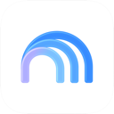</a> <a href="../apps/ios/google/gemini-notebook/README.md"><b>Gemini Notebook</b></a> iOS · 14 SDKs</td><td align="center" valign="top" width="16%"><a href="../apps/ios/google/gmail-email-by-google/README.md">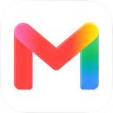</a> <a href="../apps/ios/google/gmail-email-by-google/README.md"><b>Gmail</b></a> iOS · 14 SDKs</td><td align="center" valign="top" width="16%"><a href="../apps/ios/google/google/README.md">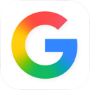</a> <a href="../apps/ios/google/google/README.md"><b>Google</b></a> iOS · 13 SDKs</td><td align="center" valign="top" width="16%"><a href="../apps/ios/google/google-authenticator/README.md">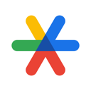</a> <a href="../apps/ios/google/google-authenticator/README.md"><b>Google Authenticator</b></a> iOS · 16 SDKs</td><td align="center" valign="top" width="16%"><a href="../apps/ios/google/google-calendar/README.md">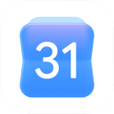</a> <a href="../apps/ios/google/google-calendar/README.md"><b>Google Calendar</b></a> iOS · 9 SDKs</td><td align="center" valign="top" width="16%"> <a href="../apps/ios/google/google-classroom/README.md"><b>Google Classroom</b></a> iOS · 11 SDKs</td></tr>
<tr><td align="center" valign="top" width="16%"><a href="../apps/ios/google/google-docs/README.md">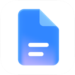</a> <a href="../apps/ios/google/google-docs/README.md"><b>Google Docs</b></a> iOS · 12 SDKs</td><td align="center" valign="top" width="16%"><a href="../apps/ios/google/google-drive/README.md">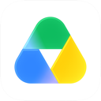</a> <a href="../apps/ios/google/google-drive/README.md"><b>Google Drive</b></a> iOS · 7 SDKs</td><td align="center" valign="top" width="16%"><a href="../apps/ios/google/gemini/README.md">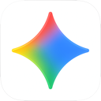</a> <a href="../apps/ios/google/gemini/README.md"><b>Google Gemini</b></a> iOS · 10 SDKs</td><td align="center" valign="top" width="16%"><a href="../apps/ios/google/google-home/README.md">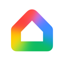</a> <a href="../apps/ios/google/google-home/README.md"><b>Google Home</b></a> iOS · 23 SDKs</td><td align="center" valign="top" width="16%"><a href="../apps/ios/google/google-keep/README.md">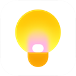</a> <a href="../apps/ios/google/google-keep/README.md"><b>Google Keep</b></a> iOS · 9 SDKs</td><td align="center" valign="top" width="16%"><a href="../apps/ios/google/google-maps/README.md">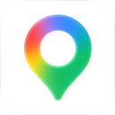</a> <a href="../apps/ios/google/google-maps/README.md"><b>Google Maps</b></a> iOS · 15 SDKs</td></tr>
<tr><td align="center" valign="top" width="16%"><a href="../apps/ios/google/google-meet/README.md">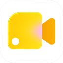</a> <a href="../apps/ios/google/google-meet/README.md"><b>Google Meet</b></a> iOS · 14 SDKs</td><td align="center" valign="top" width="16%"><a href="../apps/ios/google/google-news/README.md">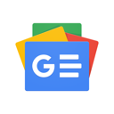</a> <a href="../apps/ios/google/google-news/README.md"><b>Google News</b></a> iOS · 13 SDKs</td><td align="center" valign="top" width="16%"><a href="../apps/ios/google/google-photos/README.md">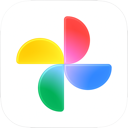</a> <a href="../apps/ios/google/google-photos/README.md"><b>Google Photos</b></a> iOS · 13 SDKs</td><td align="center" valign="top" width="16%"> <a href="../apps/ios/google/google-sheets/README.md"><b>Google Sheets</b></a> iOS · 11 SDKs</td><td align="center" valign="top" width="16%"><a href="../apps/ios/google/google-slides/README.md">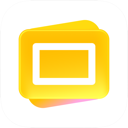</a> <a href="../apps/ios/google/google-slides/README.md"><b>Google Slides</b></a> iOS · 13 SDKs</td><td align="center" valign="top" width="16%"><a href="../apps/ios/google/google-translate/README.md">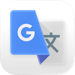</a> <a href="../apps/ios/google/google-translate/README.md"><b>Google Translate</b></a> iOS · 9 SDKs</td></tr>
<tr><td align="center" valign="top" width="16%"><a href="../apps/ios/google/google-voice/README.md">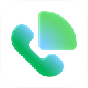</a> <a href="../apps/ios/google/google-voice/README.md"><b>Google Voice</b></a> iOS · 3 SDKs</td><td align="center" valign="top" width="16%"> <a href="../apps/ios/google/youtube/README.md"><b>YouTube</b></a> iOS · 19 SDKs</td><td align="center" valign="top" width="16%"> <a href="../apps/ios/google/youtube-music/README.md"><b>YouTube Music</b></a> iOS · 19 SDKs</td></tr>
</table>

## Apps

| | App | Platform | Versions | Latest | Analysed | SDKs | Tracked |
|---|---|---|---|---|---|---|---|
|  | [Gemini Notebook](../apps/ios/google/gemini-notebook/README.md) | iOS | 1 | 1.64.1 | 2026-10-24 | 14 | Yes |
|  | [Gmail - Email by Google](../apps/ios/google/gmail-email-by-google/README.md) | iOS | 1 | 6.0.260525 | 2026-06-19 | 14 | No |
|  | [Google](../apps/ios/google/google/README.md) | iOS | 1 | 423.5 | 2026-06-19 | 13 | No |
|  | [Google Authenticator](../apps/ios/google/google-authenticator/README.md) | iOS | 1 | 5.0.0 | 2026-06-23 | 16 | No |
|  | [Google Calendar: Get Organized](../apps/ios/google/google-calendar/README.md) | iOS | 1 | 26.20.0 | 2026-06-19 | 9 | No |
|  | [Google Classroom](../apps/ios/google/google-classroom/README.md) | iOS | 1 | 3.59.300048840 | 2026-06-23 | 11 | No |
|  | [Google Docs](../apps/ios/google/google-docs/README.md) | iOS | 1 | 1.2026.22203 | 2026-06-19 | 12 | No |
|  | [Google Drive](../apps/ios/google/google-drive/README.md) | iOS | 2 | 4.2622.41005 | 2026-06-19 | 7 | No |
|  | [Google Gemini](../apps/ios/google/gemini/README.md) | iOS | 3 | 1.2026.4171302 | 2026-10-23 | 10 | Yes |
|  | [Google Home](../apps/ios/google/google-home/README.md) | iOS | 1 | 4.17.55 | 2026-06-23 | 23 | No |
|  | [Google Keep - Notes and lists](../apps/ios/google/google-keep/README.md) | iOS | 2 | 2.2026.43101 | 2026-11-01 | 9 | No |
|  | [Google Maps](../apps/ios/google/google-maps/README.md) | iOS | 1 | 26.22.2 | 2026-06-19 | 15 | No |
|  | [Google Meet](../apps/ios/google/google-meet/README.md) | iOS | 4 | 384.0 | 2026-11-10 | 14 | No |
|  | [Google News](../apps/ios/google/google-news/README.md) | iOS | 1 | 5.118 | 2026-06-19 | 13 | No |
|  | [Google Photos: Backup & Edit](../apps/ios/google/google-photos/README.md) | iOS | 1 | 7.79.0 | 2026-06-19 | 13 | No |
|  | [Google Sheets](../apps/ios/google/google-sheets/README.md) | iOS | 1 | 1.2026.22200 | 2026-06-11 | 11 | No |
|  | [Google Slides](../apps/ios/google/google-slides/README.md) | iOS | 1 | 1.2026.22200 | 2026-06-19 | 13 | No |
|  | [Google Translate](../apps/ios/google/google-translate/README.md) | iOS | 1 | 10.21.273 | 2026-06-19 | 9 | No |
|  | [Google Voice](../apps/ios/google/google-voice/README.md) | iOS | 2 | 26.22 | 2026-06-19 | 3 | No |
|  | [YouTube](../apps/ios/google/youtube/README.md) | iOS | 1 | 21.42.4 | 2026-10-24 | 19 | No |
|  | [YouTube Music](../apps/ios/google/youtube-music/README.md) | iOS | 2 | 9.44.2 | 2026-11-04 | 19 | No |

## SDKs by category

Counted across the latest version of each app.

<picture><source media="(prefers-color-scheme: dark)" srcset="../assets/charts/companies/google-dark.svg">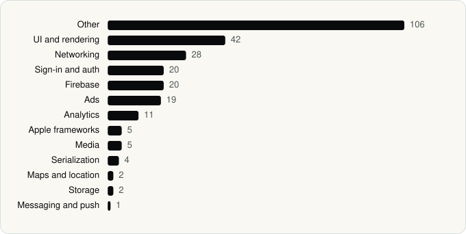</picture>

## SDKs shared across their apps

| SDK | Apps |
|---|---|
| gRPC | 18 of 21 |
| OneGoogle | 18 of 21 |
| SSOAuth | 18 of 21 |
| MaterialSearch | 17 of 21 |
| MaterialDialogs | 15 of 21 |
| GoogleKitCore | 14 of 21 |
| GoogleKitWeb | 14 of 21 |
| ABCCalloutView | 9 of 21 |
| GIPPseudonymousID | 9 of 21 |
| ChronosSiriShortcutManager | 8 of 21 |
| MaterialPullToRefresh | 8 of 21 |
| MaterialM3CTextField | 6 of 21 |
| ChronosWidgets | 5 of 21 |
| GoogleS3KitVoiceSearch | 4 of 21 |
| GWACore | 4 of 21 |
| GWALocalization | 4 of 21 |
| SwiftProtobuf | 4 of 21 |
| CardboardSDK | 3 of 21 |
| CardStyle | 3 of 21 |
| ChronosPrivacyScreen | 3 of 21 |

---

Generated by `scripts/build_readme.py` from the JSON files. Do not edit by hand.
