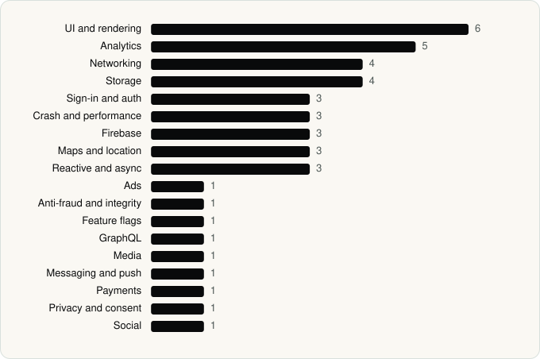

<picture><source media="(prefers-color-scheme: dark)" srcset="../assets/logo/logo-dark.svg"></picture> [Tech Stack](../README.md) / [Companies](README.md) / Hotels.com LP

# Hotels.com LP

The company name is the developer name on the store listing.

**1** apps (0 iOS, 1 Android) · **2** versions · **43** distinct SDKs across their latest versions

<table>
<tr><td align="center" valign="top" width="16%"> <a href="../apps/android/hotels-com-lp/hotels-com/README.md"><b>Hotels.com</b></a> Android · 43 SDKs</td></tr>
</table>

## Apps

| | App | Platform | Versions | Latest | Analysed | SDKs | Tracked |
|---|---|---|---|---|---|---|---|
|  | [Hotels.com: Travel Booking](../apps/android/hotels-com-lp/hotels-com/README.md) | Android | 2 | 2026.43.0 | 2026-11-02 | 43 | No |

## SDKs by category

Counted across the latest version of each app.

<picture><source media="(prefers-color-scheme: dark)" srcset="../assets/charts/companies/hotels-com-lp-dark.svg"></picture>

---

Generated by `scripts/build_readme.py` from the JSON files. Do not edit by hand.
