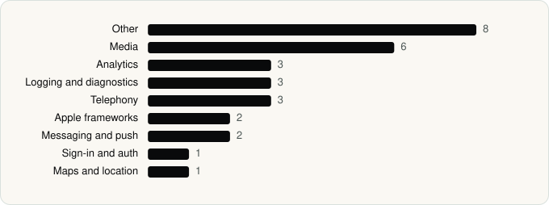

<picture><source media="(prefers-color-scheme: dark)" srcset="../assets/logo/logo-dark.svg"></picture> [Tech Stack](../README.md) / [Companies](README.md) / Instagram, Inc.

# Instagram, Inc.

The company name is the developer name on the store listing.

**4** apps (4 iOS, 0 Android) · **5** versions · **17** distinct SDKs across their latest versions

<table>
<tr><td align="center" valign="top" width="16%"> <a href="../apps/ios/instagram-inc/edits/README.md"><b>Edits</b></a> iOS · 6 SDKs</td><td align="center" valign="top" width="16%"> <a href="../apps/ios/instagram-inc/instagram/README.md"><b>Instagram</b></a> iOS · 13 SDKs</td><td align="center" valign="top" width="16%"> <a href="../apps/ios/instagram-inc/instants-an-instagram-app/README.md"><b>Instants</b></a> iOS · 7 SDKs</td><td align="center" valign="top" width="16%"> <a href="../apps/ios/instagram-inc/threads/README.md"><b>Threads</b></a> iOS · 10 SDKs</td></tr>
</table>

## Apps

| | App | Platform | Versions | Latest | Analysed | SDKs | Tracked |
|---|---|---|---|---|---|---|---|
|  | [Edits: Video Editor](../apps/ios/instagram-inc/edits/README.md) | iOS | 1 | 452.1.0 | 2026-10-24 | 6 | Yes |
|  | [Instagram](../apps/ios/instagram-inc/instagram/README.md) | iOS | 1 | 432.0.0 | 2026-06-23 | 13 | Yes |
|  | [Instants – an Instagram app](../apps/ios/instagram-inc/instants-an-instagram-app/README.md) | iOS | 1 | 454.0.0 | 2026-11-05 | 7 | Yes |
|  | [Threads](../apps/ios/instagram-inc/threads/README.md) | iOS | 2 | 452.1.0 | 2026-10-23 | 10 | Yes |

## SDKs by category

Counted across the latest version of each app.

<picture><source media="(prefers-color-scheme: dark)" srcset="../assets/charts/companies/instagram-inc-dark.svg"></picture>

## SDKs shared across their apps

| SDK | Apps |
|---|---|
| Facebook SDK | 4 of 4 |
| FBBrowserIntegrityLoggingKit | 4 of 4 |
| IGDrawKit | 4 of 4 |
| libPhoneNumber | 4 of 4 |
| BCNRefreshSounds | 3 of 4 |
| Intercom | 3 of 4 |
| libavcodec | 2 of 4 |
| libavutil | 2 of 4 |
| Mapbox | 2 of 4 |

---

Generated by `scripts/build_readme.py` from the JSON files. Do not edit by hand.
