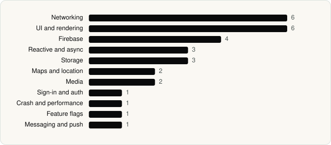

<picture><source media="(prefers-color-scheme: dark)" srcset="../assets/logo/logo-dark.svg"></picture> [Tech Stack](../README.md) / [Companies](README.md) / JPMorgan Chase

# JPMorgan Chase

The company name is the developer name on the store listing.

**2** apps (0 iOS, 2 Android) · **2** versions · **26** distinct SDKs across their latest versions

<table>
<tr><td align="center" valign="top" width="16%"> <a href="../apps/android/jpmorgan-chase/chase-mobile/README.md"><b>Chase Mobile</b></a> Android · 26 SDKs</td><td align="center" valign="top" width="16%"> <a href="../apps/android/jpmorgan-chase/chase-mobile-checkout/README.md"><b>Chase Mobile Checkout</b></a> Android · 4 SDKs</td></tr>
</table>

## Apps

| | App | Platform | Versions | Latest | Analysed | SDKs | Tracked |
|---|---|---|---|---|---|---|---|
|  | [Chase Mobile](../apps/android/jpmorgan-chase/chase-mobile/README.md) | Android | 1 | 4.662 | 2026-06-23 | 26 | No |
|  | [Chase Mobile Checkout](../apps/android/jpmorgan-chase/chase-mobile-checkout/README.md) | Android | 1 | 4.3.1 | 2026-06-19 | 4 | No |

## SDKs by category

Counted across the latest version of each app.

<picture><source media="(prefers-color-scheme: dark)" srcset="../assets/charts/companies/jpmorgan-chase-dark.svg"></picture>

## SDKs shared across their apps

| SDK | Apps |
|---|---|
| Google Play services | 2 of 2 |
| Kotlin Coroutines | 2 of 2 |
| Material Components | 2 of 2 |
| OkHttp | 2 of 2 |

---

Generated by `scripts/build_readme.py` from the JSON files. Do not edit by hand.
