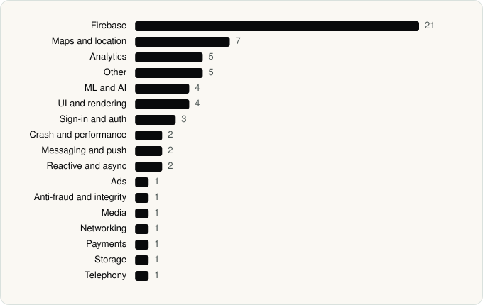

<picture><source media="(prefers-color-scheme: dark)" srcset="../assets/logo/logo-dark.svg"></picture> [Tech Stack](../README.md) / [Companies](README.md) / Lyft, Inc.

# Lyft, Inc.

The company name is the developer name on the store listing.

**3** apps (2 iOS, 1 Android) · **3** versions · **54** distinct SDKs across their latest versions

<table>
<tr><td align="center" valign="top" width="16%"> <a href="../apps/android/lyft-inc/lyft/README.md"><b>Lyft</b></a> Android · 30 SDKs</td><td align="center" valign="top" width="16%"> <a href="../apps/ios/lyft-inc/lyft/README.md"><b>Lyft</b></a> iOS · 14 SDKs</td><td align="center" valign="top" width="16%"> <a href="../apps/ios/lyft-inc/tfl-santander-cycles/README.md"><b>TfL Santander Cycles</b></a> iOS · 18 SDKs</td></tr>
</table>

## Apps

| | App | Platform | Versions | Latest | Analysed | SDKs | Tracked |
|---|---|---|---|---|---|---|---|
|  | [Lyft](../apps/android/lyft-inc/lyft/README.md) | Android | 1 | 2026.21.3.1780471452 | 2026-06-19 | 30 | No |
|  | [Lyft](../apps/ios/lyft-inc/lyft/README.md) | iOS | 1 | 2026.41.3 | 2026-10-24 | 14 | No |
|  | [TfL Santander Cycles](../apps/ios/lyft-inc/tfl-santander-cycles/README.md) | iOS | 1 | 2026.36.36 | 2026-11-17 | 18 | No |

## SDKs by category

Counted across the latest version of each app.

<picture><source media="(prefers-color-scheme: dark)" srcset="../assets/charts/companies/lyft-inc-dark.svg"></picture>

## SDKs shared across their apps

| SDK | Apps |
|---|---|
| FBLPromises | 2 of 3 |
| Firebase | 2 of 3 |
| FirebaseCore | 2 of 3 |
| FirebaseCoreInternal | 2 of 3 |
| FirebaseInstallations | 2 of 3 |
| GoogleUtilities | 2 of 3 |
| Mapbox | 2 of 3 |
| nanopb | 2 of 3 |

---

Generated by `scripts/build_readme.py` from the JSON files. Do not edit by hand.
