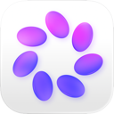
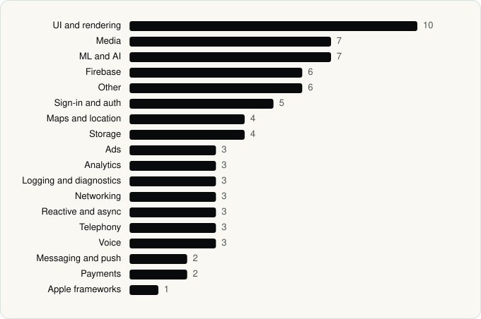

<picture><source media="(prefers-color-scheme: dark)" srcset="../assets/logo/logo-dark.svg"></picture> [Tech Stack](../README.md) / [Companies](README.md) / Meta Platforms, Inc.

# Meta Platforms, Inc.

The company name is the developer name on the store listing.

**6** apps (3 iOS, 3 Android) · **11** versions · **46** distinct SDKs across their latest versions

<table>
<tr><td align="center" valign="top" width="16%"> <a href="../apps/android/meta-platforms-inc/facebook/README.md"><b>Facebook</b></a> Android · 2 SDKs</td><td align="center" valign="top" width="16%"> <a href="../apps/ios/meta-platforms-inc/facebook/README.md"><b>Facebook</b></a> iOS · 11 SDKs</td><td align="center" valign="top" width="16%"> <a href="../apps/ios/meta-platforms-inc/messenger/README.md"><b>Messenger</b></a> iOS · 1 SDKs</td><td align="center" valign="top" width="16%"> <a href="../apps/android/meta-platforms-inc/meta-ai/README.md"><b>Meta AI</b></a> Android · 32 SDKs</td><td align="center" valign="top" width="16%"> <a href="../apps/ios/meta-platforms-inc/meta-ai/README.md"><b>Meta AI</b></a> iOS · 6 SDKs</td><td align="center" valign="top" width="16%"> <a href="../apps/android/meta-platforms-inc/muse-from-meta/README.md"><b>Muse from Meta</b></a> Android · 23 SDKs</td></tr>
</table>

## Apps

| | App | Platform | Versions | Latest | Analysed | SDKs | Tracked |
|---|---|---|---|---|---|---|---|
|  | [Facebook](../apps/android/meta-platforms-inc/facebook/README.md) | Android | 2 | 585.0.0.47.54 | 2026-11-02 | 2 | Yes |
|  | [Facebook](../apps/ios/meta-platforms-inc/facebook/README.md) | iOS | 1 | 564.0.0 | 2026-06-23 | 11 | Yes |
|  | [Messenger](../apps/ios/meta-platforms-inc/messenger/README.md) | iOS | 1 | 563.0.0 | 2026-06-23 | 1 | Yes |
|  | [Meta AI](../apps/android/meta-platforms-inc/meta-ai/README.md) | Android | 1 | 295.0.0.37.164 | 2026-10-24 | 32 | Yes |
|  | [Meta AI](../apps/ios/meta-platforms-inc/meta-ai/README.md) | iOS | 5 | 297.0.0 | 2026-11-04 | 6 | Yes |
|  | [Muse from Meta](../apps/android/meta-platforms-inc/muse-from-meta/README.md) | Android | 1 | 14.0.0.4.149 | 2026-11-01 | 23 | Yes |

## SDKs by category

Counted across the latest version of each app.

<picture><source media="(prefers-color-scheme: dark)" srcset="../assets/charts/companies/meta-platforms-inc-dark.svg"></picture>

## SDKs shared across their apps

| SDK | Apps |
|---|---|
| Facebook SDK | 3 of 6 |
| Kotlin Coroutines | 3 of 6 |
| libPhoneNumber | 3 of 6 |
| Credential Manager | 2 of 6 |
| DataStore | 2 of 6 |
| ExoPlayer | 2 of 6 |
| Firebase | 2 of 6 |
| Firebase Messaging | 2 of 6 |
| Flipper | 2 of 6 |
| Fresco | 2 of 6 |
| Google DataTransport | 2 of 6 |
| Google Location | 2 of 6 |
| Google Mobile Ads (AdMob) | 2 of 6 |
| Google Play Billing | 2 of 6 |
| Google Play services | 2 of 6 |
| Google Sign-In / Auth | 2 of 6 |
| Jetpack Compose | 2 of 6 |
| Lottie | 2 of 6 |
| Mapbox | 2 of 6 |
| Material Components | 2 of 6 |

---

Generated by `scripts/build_readme.py` from the JSON files. Do not edit by hand.
