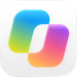
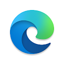
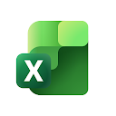
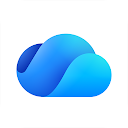
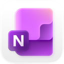
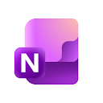
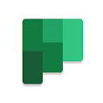
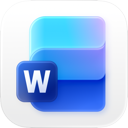
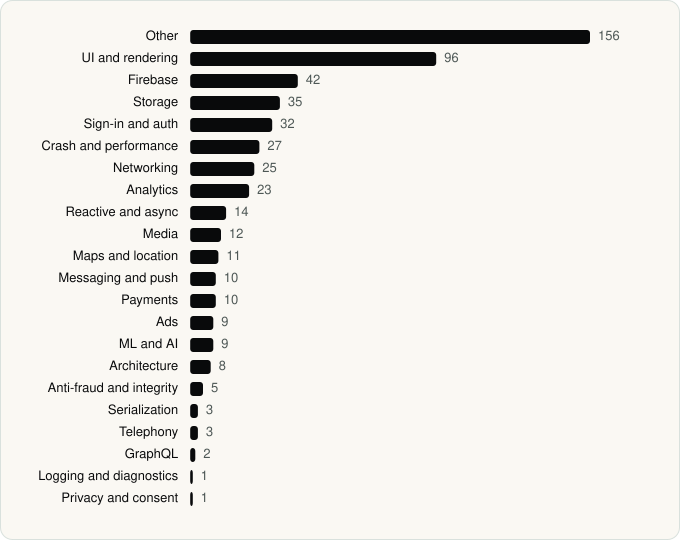

<picture><source media="(prefers-color-scheme: dark)" srcset="../assets/logo/logo-dark.svg"></picture> [Tech Stack](../README.md) / [Companies](README.md) / Microsoft Corporation

# Microsoft Corporation

The company name is the developer name on the store listing.

**20** apps (8 iOS, 12 Android) · **27** versions · **249** distinct SDKs across their latest versions

<table>
<tr><td align="center" valign="top" width="16%"> <a href="../apps/android/microsoft-corporation/microsoft-authenticator/README.md"><b>Microsoft Authenticator</b></a> Android · 25 SDKs</td><td align="center" valign="top" width="16%"> <a href="../apps/ios/microsoft-corporation/microsoft-authenticator/README.md"><b>Microsoft Authenticator</b></a> iOS · 11 SDKs</td><td align="center" valign="top" width="16%"> <a href="../apps/ios/microsoft-corporation/microsoft-bing-search/README.md"><b>Microsoft Bing Search</b></a> iOS · 117 SDKs</td><td align="center" valign="top" width="16%"> <a href="../apps/android/microsoft-corporation/microsoft-bing-webmaster-tools/README.md"><b>Microsoft Bing Webmaster Tools</b></a> Android · 0 SDKs</td><td align="center" valign="top" width="16%"> <a href="../apps/ios/microsoft-corporation/microsoft-copilot/README.md"><b>Microsoft Copilot</b></a> iOS · 10 SDKs</td><td align="center" valign="top" width="16%"> <a href="../apps/android/microsoft-corporation/microsoft-edge/README.md"><b>Microsoft Edge</b></a> Android · 33 SDKs</td></tr>
<tr><td align="center" valign="top" width="16%"> <a href="../apps/ios/microsoft-corporation/microsoft-edge/README.md"><b>Microsoft Edge</b></a> iOS · 88 SDKs</td><td align="center" valign="top" width="16%"> <a href="../apps/android/microsoft-corporation/microsoft-excel/README.md"><b>Microsoft Excel</b></a> Android · 27 SDKs</td><td align="center" valign="top" width="16%"> <a href="../apps/android/microsoft-corporation/microsoft-onedrive/README.md"><b>Microsoft OneDrive</b></a> Android · 28 SDKs</td><td align="center" valign="top" width="16%"> <a href="../apps/ios/microsoft-corporation/microsoft-onenote/README.md"><b>Microsoft OneNote</b></a> iOS · 2 SDKs</td><td align="center" valign="top" width="16%"> <a href="../apps/android/microsoft-corporation/microsoft-onenote/README.md"><b>Microsoft OneNote</b></a> Android · 19 SDKs</td><td align="center" valign="top" width="16%"> <a href="../apps/android/microsoft-corporation/microsoft-outlook/README.md"><b>Microsoft Outlook</b></a> Android · 36 SDKs</td></tr>
<tr><td align="center" valign="top" width="16%"> <a href="../apps/android/microsoft-corporation/microsoft-planner/README.md"><b>Microsoft Planner</b></a> Android · 16 SDKs</td><td align="center" valign="top" width="16%"> <a href="../apps/android/microsoft-corporation/microsoft-powerpoint/README.md"><b>Microsoft PowerPoint</b></a> Android · 28 SDKs</td><td align="center" valign="top" width="16%"> <a href="../apps/android/microsoft-corporation/microsoft-teams/README.md"><b>Microsoft Teams</b></a> Android · 35 SDKs</td><td align="center" valign="top" width="16%"> <a href="../apps/ios/microsoft-corporation/microsoft-teams/README.md"><b>Microsoft Teams</b></a> iOS · 51 SDKs</td><td align="center" valign="top" width="16%"> <a href="../apps/ios/microsoft-corporation/microsoft-to-do/README.md"><b>Microsoft To Do</b></a> iOS · 12 SDKs</td><td align="center" valign="top" width="16%"> <a href="../apps/ios/microsoft-corporation/microsoft-word/README.md"><b>Microsoft Word</b></a> iOS · 11 SDKs</td></tr>
<tr><td align="center" valign="top" width="16%"> <a href="../apps/android/microsoft-corporation/microsoft-word/README.md"><b>Microsoft Word</b></a> Android · 28 SDKs</td><td align="center" valign="top" width="16%"> <a href="../apps/android/microsoft-corporation/msn/README.md"><b>MSN</b></a> Android · 25 SDKs</td></tr>
</table>

## Apps

| | App | Platform | Versions | Latest | Analysed | SDKs | Tracked |
|---|---|---|---|---|---|---|---|
|  | [Microsoft Authenticator](../apps/android/microsoft-corporation/microsoft-authenticator/README.md) | Android | 1 | 6.2605.3042 | 2026-06-23 | 25 | Yes |
|  | [Microsoft Authenticator](../apps/ios/microsoft-corporation/microsoft-authenticator/README.md) | iOS | 1 | 6.8.48 | 2026-06-19 | 11 | No |
|  | [Microsoft Bing Search](../apps/ios/microsoft-corporation/microsoft-bing-search/README.md) | iOS | 2 | 33.4.440605001 | 2026-06-19 | 117 | No |
|  | [Microsoft Bing Webmaster Tools](../apps/android/microsoft-corporation/microsoft-bing-webmaster-tools/README.md) | Android | 1 | 1.0.3 | 2026-06-19 | 0 | Yes |
|  | [Microsoft Copilot](../apps/ios/microsoft-corporation/microsoft-copilot/README.md) | iOS | 1 | 2.115.1 | 2026-10-24 | 10 | Yes |
|  | [Microsoft Edge](../apps/android/microsoft-corporation/microsoft-edge/README.md) | Android | 1 | 148.0.3967.97 | 2026-06-19 | 33 | Yes |
|  | [Microsoft Edge](../apps/ios/microsoft-corporation/microsoft-edge/README.md) | iOS | 2 | 156.4314.56 | 2026-11-02 | 88 | Yes |
|  | [Microsoft Excel: Spreadsheets](../apps/android/microsoft-corporation/microsoft-excel/README.md) | Android | 1 | 16.0.19822.20104 | 2026-06-19 | 27 | Yes |
|  | [Microsoft OneDrive](../apps/android/microsoft-corporation/microsoft-onedrive/README.md) | Android | 1 | 7.56 | 2026-06-19 | 28 | Yes |
|  | [Microsoft OneNote](../apps/ios/microsoft-corporation/microsoft-onenote/README.md) | iOS | 1 | 16.109.3 | 2026-06-11 | 2 | No |
|  | [Microsoft OneNote: Save Notes](../apps/android/microsoft-corporation/microsoft-onenote/README.md) | Android | 1 | 16.0.19127.20320 | 2026-06-19 | 19 | No |
|  | [Microsoft Outlook](../apps/android/microsoft-corporation/microsoft-outlook/README.md) | Android | 1 | 5.2606.0 | 2026-06-19 | 36 | Yes |
|  | [Microsoft Planner](../apps/android/microsoft-corporation/microsoft-planner/README.md) | Android | 2 | 1.18.40 | 2026-11-04 | 16 | No |
|  | [Microsoft PowerPoint](../apps/android/microsoft-corporation/microsoft-powerpoint/README.md) | Android | 1 | 16.0.19822.20104 | 2026-06-19 | 28 | Yes |
|  | [Microsoft Teams](../apps/android/microsoft-corporation/microsoft-teams/README.md) | Android | 2 | 1416/1.0.0.2026202302 | 2026-11-04 | 35 | Yes |
|  | [Microsoft Teams](../apps/ios/microsoft-corporation/microsoft-teams/README.md) | iOS | 3 | 8.19.3 | 2026-11-06 | 51 | Yes |
|  | [Microsoft To Do](../apps/ios/microsoft-corporation/microsoft-to-do/README.md) | iOS | 2 | 2.177 | 2026-11-02 | 12 | No |
|  | [Microsoft Word](../apps/ios/microsoft-corporation/microsoft-word/README.md) | iOS | 1 | 2.115.2 | 2026-11-03 | 11 | Yes |
|  | [Microsoft Word: Edit Documents](../apps/android/microsoft-corporation/microsoft-word/README.md) | Android | 1 | 16.0.19822.20104 | 2026-06-19 | 28 | Yes |
|  | [MSN](../apps/android/microsoft-corporation/msn/README.md) | Android | 1 | 33.3.440518006 | 2026-06-19 | 25 | No |

## SDKs by category

Counted across the latest version of each app.

<picture><source media="(prefers-color-scheme: dark)" srcset="../assets/charts/companies/microsoft-corporation-dark.svg"></picture>

## SDKs shared across their apps

| SDK | Apps |
|---|---|
| Lottie | 15 of 20 |
| Firebase | 12 of 20 |
| Credential Manager | 11 of 20 |
| Google DataTransport | 11 of 20 |
| Google Play services | 11 of 20 |
| Google Sign-In / Auth | 11 of 20 |
| Jetpack Compose | 11 of 20 |
| Kotlin Coroutines | 11 of 20 |
| Material Components | 11 of 20 |
| OkHttp | 11 of 20 |
| OpenTelemetry | 11 of 20 |
| Firebase Messaging | 10 of 20 |
| Okio | 10 of 20 |
| Room | 10 of 20 |
| App Center | 9 of 20 |
| Media3 (ExoPlayer) | 9 of 20 |
| Retrofit | 9 of 20 |
| Coil | 8 of 20 |
| Markwon | 8 of 20 |
| Firebase Analytics | 7 of 20 |

---

Generated by `scripts/build_readme.py` from the JSON files. Do not edit by hand.
