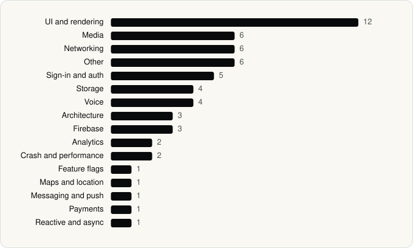

<picture><source media="(prefers-color-scheme: dark)" srcset="../assets/logo/logo-dark.svg"></picture> [Tech Stack](../README.md) / [Companies](README.md) / Mistral AI

# Mistral AI

The company name is the developer name on the store listing.

**2** apps (1 iOS, 1 Android) · **2** versions · **54** distinct SDKs across their latest versions

<table>
<tr><td align="center" valign="top" width="16%"> <a href="../apps/android/mistral-ai/le-chat/README.md"><b>Le Chat by Mistral AI</b></a> Android · 34 SDKs</td><td align="center" valign="top" width="16%"> <a href="../apps/ios/mistral-ai/le-chat/README.md"><b>Le Chat by Mistral AI</b></a> iOS · 24 SDKs</td></tr>
</table>

## Apps

| | App | Platform | Versions | Latest | Analysed | SDKs | Tracked |
|---|---|---|---|---|---|---|---|
|  | [Le Chat by Mistral AI](../apps/android/mistral-ai/le-chat/README.md) | Android | 1 | 2.16.0 | 2026-10-24 | 34 | Yes |
|  | [Le Chat by Mistral AI](../apps/ios/mistral-ai/le-chat/README.md) | iOS | 1 | 2.16.0 | 2026-10-24 | 24 | Yes |

## SDKs by category

Counted across the latest version of each app.

<picture><source media="(prefers-color-scheme: dark)" srcset="../assets/charts/companies/mistral-ai-dark.svg"></picture>

## SDKs shared across their apps

| SDK | Apps |
|---|---|
| Axios | 2 of 2 |
| LiveKit | 2 of 2 |
| MobX | 2 of 2 |
| React Native Reanimated | 2 of 2 |

---

Generated by `scripts/build_readme.py` from the JSON files. Do not edit by hand.
