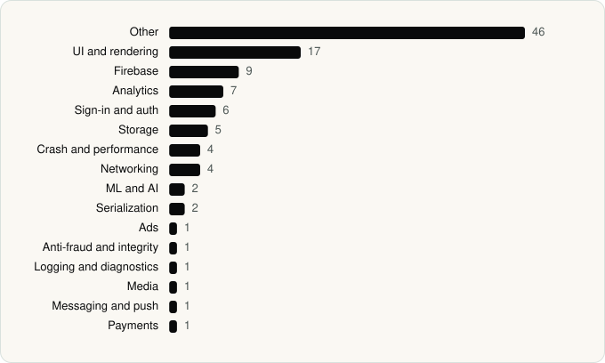

<picture><source media="(prefers-color-scheme: dark)" srcset="../assets/logo/logo-dark.svg"></picture> [Tech Stack](../README.md) / [Companies](README.md) / Moonshot AI

# Moonshot AI

The company name is the developer name on the store listing.

**2** apps (1 iOS, 1 Android) · **2** versions · **107** distinct SDKs across their latest versions

<table>
<tr><td align="center" valign="top" width="16%"> <a href="../apps/android/moonshot-ai/kimi/README.md"><b>Kimi</b></a> Android · 26 SDKs</td><td align="center" valign="top" width="16%"> <a href="../apps/ios/moonshot-ai/kimi/README.md"><b>Kimi</b></a> iOS · 82 SDKs</td></tr>
</table>

## Apps

| | App | Platform | Versions | Latest | Analysed | SDKs | Tracked |
|---|---|---|---|---|---|---|---|
|  | [Kimi](../apps/android/moonshot-ai/kimi/README.md) | Android | 1 | 3.1.5 | 2026-10-24 | 26 | Yes |
|  | [Kimi - Your Personal AI Agent](../apps/ios/moonshot-ai/kimi/README.md) | iOS | 1 | 3.1.6 | 2026-10-24 | 82 | Yes |

## SDKs by category

Counted across the latest version of each app.

<picture><source media="(prefers-color-scheme: dark)" srcset="../assets/charts/companies/moonshot-ai-dark.svg"></picture>

## SDKs shared across their apps

| SDK | Apps |
|---|---|
| MMKV | 2 of 2 |

---

Generated by `scripts/build_readme.py` from the JSON files. Do not edit by hand.
