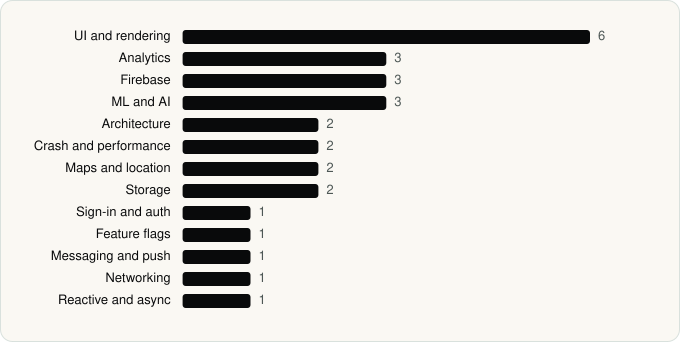

<picture><source media="(prefers-color-scheme: dark)" srcset="../assets/logo/logo-dark.svg"></picture> [Tech Stack](../README.md) / [Companies](README.md) / MorelandConnect

# MorelandConnect

The company name is the developer name on the store listing.

**1** apps (0 iOS, 1 Android) · **1** versions · **28** distinct SDKs across their latest versions

<table>
<tr><td align="center" valign="top" width="16%"> <a href="../apps/android/morelandconnect/blueskyvue/README.md"><b>BlueSkyVUE</b></a> Android · 28 SDKs</td></tr>
</table>

## Apps

| | App | Platform | Versions | Latest | Analysed | SDKs | Tracked |
|---|---|---|---|---|---|---|---|
|  | [BlueSkyVUE](../apps/android/morelandconnect/blueskyvue/README.md) | Android | 1 | 2.13.0 | 2026-06-19 | 28 | No |

## SDKs by category

Counted across the latest version of each app.

<picture><source media="(prefers-color-scheme: dark)" srcset="../assets/charts/companies/morelandconnect-dark.svg"></picture>

---

Generated by `scripts/build_readme.py` from the JSON files. Do not edit by hand.
