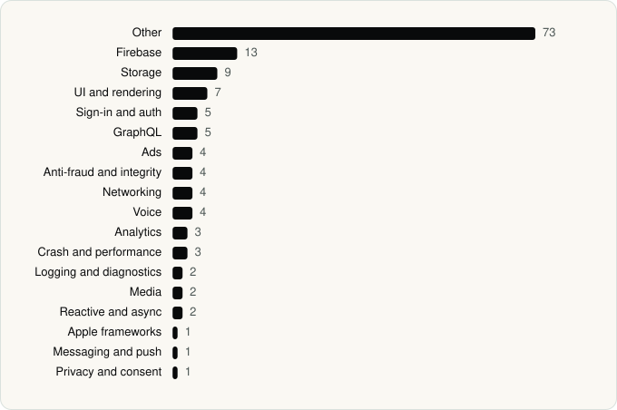

<picture><source media="(prefers-color-scheme: dark)" srcset="../assets/logo/logo-dark.svg"></picture> [Tech Stack](../README.md) / [Companies](README.md) / Netflix, Inc.

# Netflix, Inc.

The company name is the developer name on the store listing.

**3** apps (2 iOS, 1 Android) · **3** versions · **126** distinct SDKs across their latest versions

<table>
<tr><td align="center" valign="top" width="16%"> <a href="../apps/android/netflix-inc/netflix/README.md"><b>Netflix</b></a> Android · 29 SDKs</td><td align="center" valign="top" width="16%"> <a href="../apps/ios/netflix-inc/netflix/README.md"><b>Netflix</b></a> iOS · 74 SDKs</td><td align="center" valign="top" width="16%"> <a href="../apps/ios/netflix-inc/netflix-game-controller/README.md"><b>Netflix Game Controller</b></a> iOS · 40 SDKs</td></tr>
</table>

## Apps

| | App | Platform | Versions | Latest | Analysed | SDKs | Tracked |
|---|---|---|---|---|---|---|---|
|  | [Netflix](../apps/android/netflix-inc/netflix/README.md) | Android | 1 | 9.65.0 build 9 64253 | 2026-06-19 | 29 | Yes |
|  | [Netflix](../apps/ios/netflix-inc/netflix/README.md) | iOS | 1 | 18.34.0 | 2026-06-19 | 74 | Yes |
|  | [Netflix Game Controller](../apps/ios/netflix-inc/netflix-game-controller/README.md) | iOS | 1 | 3.21 | 2026-11-01 | 40 | Yes |

## SDKs by category

Counted across the latest version of each app.

<picture><source media="(prefers-color-scheme: dark)" srcset="../assets/charts/companies/netflix-inc-dark.svg"></picture>

## SDKs shared across their apps

| SDK | Apps |
|---|---|
| Lottie | 3 of 3 |
| Apollo | 2 of 3 |
| ApolloAPI | 2 of 3 |
| AuthenticationUI | 2 of 3 |
| Bugsnag | 2 of 3 |
| Callouts | 2 of 3 |
| EducationalInterstitial | 2 of 3 |
| Emojis | 2 of 3 |
| Firebase | 2 of 3 |
| GRDB | 2 of 3 |
| HawkinsComponents | 2 of 3 |
| IdentityEditor | 2 of 3 |
| NFURLSession | 2 of 3 |
| Pictograms | 2 of 3 |
| ProfileProtocol | 2 of 3 |
| RecaptchaEnterprise | 2 of 3 |

---

Generated by `scripts/build_readme.py` from the JSON files. Do not edit by hand.
