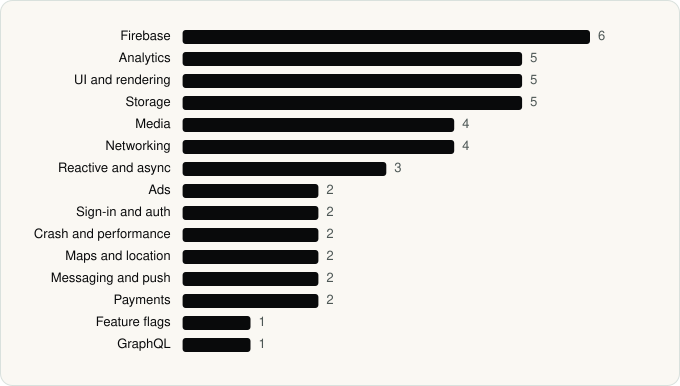

<picture><source media="(prefers-color-scheme: dark)" srcset="../assets/logo/logo-dark.svg"></picture> [Tech Stack](../README.md) / [Companies](README.md) / Pandora

# Pandora

The company name is the developer name on the store listing.

**2** apps (0 iOS, 2 Android) · **2** versions · **35** distinct SDKs across their latest versions

<table>
<tr><td align="center" valign="top" width="16%"> <a href="../apps/android/pandora/pandora/README.md"><b>Pandora</b></a> Android · 34 SDKs</td><td align="center" valign="top" width="16%"> <a href="../apps/android/pandora/pandora-music-for-tv/README.md"><b>Pandora Music for TV</b></a> Android · 12 SDKs</td></tr>
</table>

## Apps

| | App | Platform | Versions | Latest | Analysed | SDKs | Tracked |
|---|---|---|---|---|---|---|---|
|  | [Pandora - Music & Podcasts](../apps/android/pandora/pandora/README.md) | Android | 1 | 2606.1 | 2026-06-19 | 34 | No |
|  | [Pandora Music for TV](../apps/android/pandora/pandora-music-for-tv/README.md) | Android | 1 | 4.3.1 | 2026-06-19 | 12 | No |

## SDKs by category

Counted across the latest version of each app.

<picture><source media="(prefers-color-scheme: dark)" srcset="../assets/charts/companies/pandora-dark.svg"></picture>

## SDKs shared across their apps

| SDK | Apps |
|---|---|
| ExoPlayer | 2 of 2 |
| Firebase | 2 of 2 |
| Glide | 2 of 2 |
| Google DataTransport | 2 of 2 |
| Google Location | 2 of 2 |
| Google Play Billing | 2 of 2 |
| Google Play services | 2 of 2 |
| Google Sign-In / Auth | 2 of 2 |
| Kotlin Coroutines | 2 of 2 |
| OkHttp | 2 of 2 |
| Room | 2 of 2 |

---

Generated by `scripts/build_readme.py` from the JSON files. Do not edit by hand.
