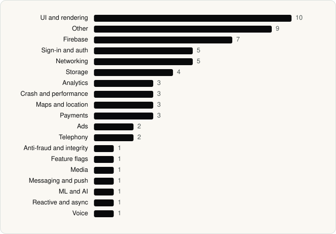

<picture><source media="(prefers-color-scheme: dark)" srcset="../assets/logo/logo-dark.svg"></picture> [Tech Stack](../README.md) / [Companies](README.md) / Perplexity AI, Inc.

# Perplexity AI, Inc.

The company name is the developer name on the store listing.

**2** apps (1 iOS, 1 Android) · **2** versions · **62** distinct SDKs across their latest versions

<table>
<tr><td align="center" valign="top" width="16%"> <a href="../apps/android/perplexity-ai-inc/perplexity/README.md"><b>Perplexity</b></a> Android · 37 SDKs</td><td align="center" valign="top" width="16%"> <a href="../apps/ios/perplexity-ai-inc/perplexity/README.md"><b>Perplexity</b></a> iOS · 26 SDKs</td></tr>
</table>

## Apps

| | App | Platform | Versions | Latest | Analysed | SDKs | Tracked |
|---|---|---|---|---|---|---|---|
|  | [Perplexity - AI Search & Chat](../apps/android/perplexity-ai-inc/perplexity/README.md) | Android | 1 | 2.101.0 | 2026-10-24 | 37 | Yes |
|  | [Perplexity - AI Search & Chat](../apps/ios/perplexity-ai-inc/perplexity/README.md) | iOS | 1 | 26.42.0 | 2026-10-24 | 26 | Yes |

## SDKs by category

Counted across the latest version of each app.

<picture><source media="(prefers-color-scheme: dark)" srcset="../assets/charts/companies/perplexity-ai-inc-dark.svg"></picture>

## SDKs shared across their apps

| SDK | Apps |
|---|---|
| RevenueCat | 2 of 2 |

---

Generated by `scripts/build_readme.py` from the JSON files. Do not edit by hand.
