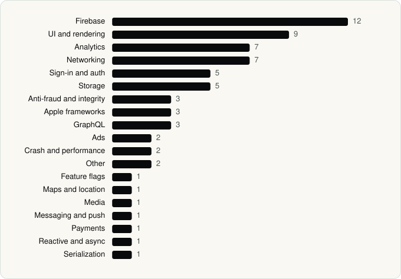

<picture><source media="(prefers-color-scheme: dark)" srcset="../assets/logo/logo-dark.svg"></picture> [Tech Stack](../README.md) / [Companies](README.md) / reddit Inc.

# reddit Inc.

The company name is the developer name on the store listing.

**2** apps (1 iOS, 1 Android) · **2** versions · **64** distinct SDKs across their latest versions

<table>
<tr><td align="center" valign="top" width="16%"> <a href="../apps/android/reddit-inc/reddit/README.md"><b>Reddit</b></a> Android · 34 SDKs</td><td align="center" valign="top" width="16%"> <a href="../apps/ios/reddit-inc/reddit/README.md"><b>Reddit</b></a> iOS · 33 SDKs</td></tr>
</table>

## Apps

| | App | Platform | Versions | Latest | Analysed | SDKs | Tracked |
|---|---|---|---|---|---|---|---|
|  | [Reddit](../apps/android/reddit-inc/reddit/README.md) | Android | 1 | 2026.22.0 | 2026-06-19 | 34 | No |
|  | [Reddit](../apps/ios/reddit-inc/reddit/README.md) | iOS | 1 | 2026.22.0 | 2026-06-19 | 33 | No |

## SDKs by category

Counted across the latest version of each app.

<picture><source media="(prefers-color-scheme: dark)" srcset="../assets/charts/companies/reddit-inc-dark.svg"></picture>

## SDKs shared across their apps

| SDK | Apps |
|---|---|
| Branch | 2 of 2 |
| Firebase | 2 of 2 |
| Lottie | 2 of 2 |

---

Generated by `scripts/build_readme.py` from the JSON files. Do not edit by hand.
