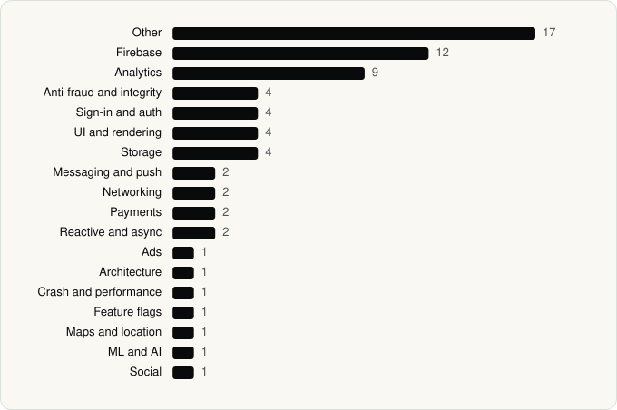

<picture><source media="(prefers-color-scheme: dark)" srcset="../assets/logo/logo-dark.svg"></picture> [Tech Stack](../README.md) / [Companies](README.md) / Roadget Business PTE. LTD.

# Roadget Business PTE. LTD.

The company name is the developer name on the store listing.

**2** apps (1 iOS, 1 Android) · **2** versions · **66** distinct SDKs across their latest versions

<table>
<tr><td align="center" valign="top" width="16%"> <a href="../apps/ios/roadget-business-pte-ltd/shein/README.md"><b>SHEIN</b></a> iOS · 41 SDKs</td><td align="center" valign="top" width="16%"> <a href="../apps/android/roadget-business-pte-ltd/shein-shopping-online/README.md"><b>SHEIN-Shopping Online</b></a> Android · 28 SDKs</td></tr>
</table>

## Apps

| | App | Platform | Versions | Latest | Analysed | SDKs | Tracked |
|---|---|---|---|---|---|---|---|
|  | [SHEIN - Shopping Online](../apps/ios/roadget-business-pte-ltd/shein/README.md) | iOS | 1 | 15.5.6 | 2026-10-24 | 41 | Yes |
|  | [SHEIN-Shopping Online](../apps/android/roadget-business-pte-ltd/shein-shopping-online/README.md) | Android | 1 | 15.5.0 | 2026-10-24 | 28 | Yes |

## SDKs by category

Counted across the latest version of each app.

<picture><source media="(prefers-color-scheme: dark)" srcset="../assets/charts/companies/roadget-business-pte-ltd-dark.svg"></picture>

## SDKs shared across their apps

| SDK | Apps |
|---|---|
| Braintree | 2 of 2 |
| Facebook SDK | 2 of 2 |
| Firebase | 2 of 2 |

---

Generated by `scripts/build_readme.py` from the JSON files. Do not edit by hand.
