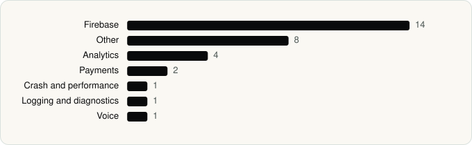

<picture><source media="(prefers-color-scheme: dark)" srcset="../assets/logo/logo-dark.svg"></picture> [Tech Stack](../README.md) / [Companies](README.md) / Shelgaon Ltd

# Shelgaon Ltd

The company name is the developer name on the store listing.

**2** apps (2 iOS, 0 Android) · **2** versions · **29** distinct SDKs across their latest versions

<table>
<tr><td align="center" valign="top" width="16%"> <a href="../apps/ios/shelgaon-ltd/kalo/README.md"><b>Kalo</b></a> iOS · 24 SDKs</td><td align="center" valign="top" width="16%"> <a href="../apps/ios/shelgaon-ltd/workout-director-gym-home/README.md"><b>Workout Director</b></a> iOS · 7 SDKs</td></tr>
</table>

## Apps

| | App | Platform | Versions | Latest | Analysed | SDKs | Tracked |
|---|---|---|---|---|---|---|---|
|  | [Kalo: AI Calorie Counter](../apps/ios/shelgaon-ltd/kalo/README.md) | iOS | 1 | 1.6.9 | 2026-06-23 | 24 | Yes |
|  | [Workout Director - Gym & Home](../apps/ios/shelgaon-ltd/workout-director-gym-home/README.md) | iOS | 1 | 1.0.89 | 2026-11-01 | 7 | Yes |

## SDKs by category

Counted across the latest version of each app.

<picture><source media="(prefers-color-scheme: dark)" srcset="../assets/charts/companies/shelgaon-ltd-dark.svg"></picture>

## SDKs shared across their apps

| SDK | Apps |
|---|---|
| BrunoDS | 2 of 2 |
| RevenueCat | 2 of 2 |

---

Generated by `scripts/build_readme.py` from the JSON files. Do not edit by hand.
