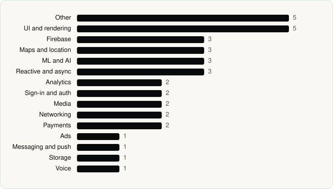

<picture><source media="(prefers-color-scheme: dark)" srcset="../assets/logo/logo-dark.svg"></picture> [Tech Stack](../README.md) / [Companies](README.md) / Snap Inc

# Snap Inc

The company name is the developer name on the store listing.

**2** apps (1 iOS, 1 Android) · **2** versions · **35** distinct SDKs across their latest versions

<table>
<tr><td align="center" valign="top" width="16%"> <a href="../apps/android/snap-inc/snapchat/README.md"><b>Snapchat</b></a> Android · 29 SDKs</td><td align="center" valign="top" width="16%"> <a href="../apps/ios/snap-inc/snapchat/README.md"><b>Snapchat</b></a> iOS · 7 SDKs</td></tr>
</table>

## Apps

| | App | Platform | Versions | Latest | Analysed | SDKs | Tracked |
|---|---|---|---|---|---|---|---|
|  | [Snapchat](../apps/android/snap-inc/snapchat/README.md) | Android | 1 | 14.29.0.50 | 2026-10-24 | 29 | Yes |
|  | [Snapchat](../apps/ios/snap-inc/snapchat/README.md) | iOS | 1 | 13.95.1 | 2026-06-19 | 7 | Yes |

## SDKs by category

Counted across the latest version of each app.

<picture><source media="(prefers-color-scheme: dark)" srcset="../assets/charts/companies/snap-inc-dark.svg"></picture>

## SDKs shared across their apps

| SDK | Apps |
|---|---|
| Mapbox | 2 of 2 |

---

Generated by `scripts/build_readme.py` from the JSON files. Do not edit by hand.
