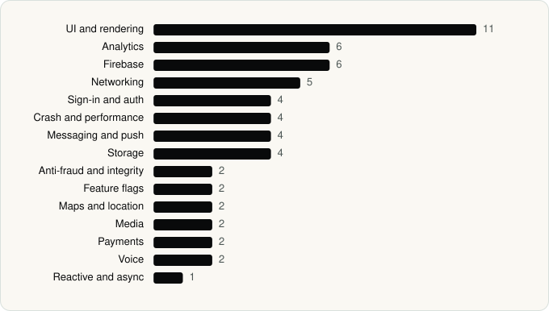

<picture><source media="(prefers-color-scheme: dark)" srcset="../assets/logo/logo-dark.svg"></picture> [Tech Stack](../README.md) / [Companies](README.md) / SpaceX Super Intelligence

# SpaceX Super Intelligence

The company name is the developer name on the store listing.

**2** apps (0 iOS, 2 Android) · **3** versions · **44** distinct SDKs across their latest versions

<table>
<tr><td align="center" valign="top" width="16%"> <a href="../apps/android/spacex-super-intelligence/grok/README.md"><b>Grok</b></a> Android · 36 SDKs</td><td align="center" valign="top" width="16%"> <a href="../apps/android/spacex-super-intelligence/grok-bot/README.md"><b>Grok Bot</b></a> Android · 20 SDKs</td></tr>
</table>

## Apps

| | App | Platform | Versions | Latest | Analysed | SDKs | Tracked |
|---|---|---|---|---|---|---|---|
|  | [Grok - AI Chat & Video](../apps/android/spacex-super-intelligence/grok/README.md) | Android | 2 | 1.2.53-release.00 | 2026-11-04 | 36 | Yes |
|  | [Grok Bot](../apps/android/spacex-super-intelligence/grok-bot/README.md) | Android | 1 | 1.5.0 | 2026-09-02 | 20 | Yes |

## SDKs by category

Counted across the latest version of each app.

<picture><source media="(prefers-color-scheme: dark)" srcset="../assets/charts/companies/spacex-super-intelligence-dark.svg"></picture>

## SDKs shared across their apps

| SDK | Apps |
|---|---|
| DataStore | 2 of 2 |
| Firebase | 2 of 2 |
| Firebase Messaging | 2 of 2 |
| Google DataTransport | 2 of 2 |
| Google Play Billing | 2 of 2 |
| Google Play services | 2 of 2 |
| Google Sign-In / Auth | 2 of 2 |
| Jetpack Compose | 2 of 2 |
| Material Components | 2 of 2 |
| Media3 (ExoPlayer) | 2 of 2 |
| OkHttp | 2 of 2 |
| Room | 2 of 2 |

---

Generated by `scripts/build_readme.py` from the JSON files. Do not edit by hand.
