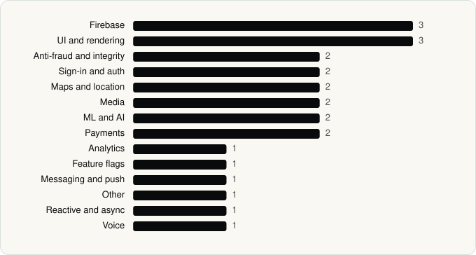

<picture><source media="(prefers-color-scheme: dark)" srcset="../assets/logo/logo-dark.svg"></picture> [Tech Stack](../README.md) / [Companies](README.md) / Telegram FZ-LLC

# Telegram FZ-LLC

The company name is the developer name on the store listing.

**2** apps (1 iOS, 1 Android) · **3** versions · **24** distinct SDKs across their latest versions

<table>
<tr><td align="center" valign="top" width="16%"> <a href="../apps/android/telegram-fz-llc/telegram/README.md"><b>Telegram</b></a> Android · 22 SDKs</td><td align="center" valign="top" width="16%"> <a href="../apps/ios/telegram-fz-llc/telegram-messenger/README.md"><b>Telegram Messenger</b></a> iOS · 2 SDKs</td></tr>
</table>

## Apps

| | App | Platform | Versions | Latest | Analysed | SDKs | Tracked |
|---|---|---|---|---|---|---|---|
|  | [Telegram](../apps/android/telegram-fz-llc/telegram/README.md) | Android | 1 | 12.7.3 | 2026-06-19 | 22 | Yes |
|  | [Telegram Messenger](../apps/ios/telegram-fz-llc/telegram-messenger/README.md) | iOS | 2 | 13.1.1 | 2026-10-23 | 2 | Yes |

## SDKs by category

Counted across the latest version of each app.

<picture><source media="(prefers-color-scheme: dark)" srcset="../assets/charts/companies/telegram-fz-llc-dark.svg"></picture>

---

Generated by `scripts/build_readme.py` from the JSON files. Do not edit by hand.
