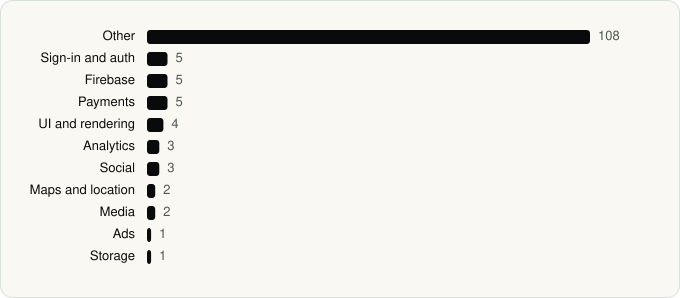

<picture><source media="(prefers-color-scheme: dark)" srcset="../assets/logo/logo-dark.svg"></picture> [Tech Stack](../README.md) / [Companies](README.md) / TikTok Ltd.

# TikTok Ltd.

The company name is the developer name on the store listing.

**2** apps (2 iOS, 0 Android) · **2** versions · **153** distinct SDKs across their latest versions

<table>
<tr><td align="center" valign="top" width="16%"> <a href="../apps/ios/tiktok-ltd/lemon8/README.md"><b>Lemon8</b></a> iOS · 57 SDKs</td><td align="center" valign="top" width="16%"> <a href="../apps/ios/tiktok-ltd/tiktok/README.md"><b>TikTok</b></a> iOS · 139 SDKs</td></tr>
</table>

## Apps

| | App | Platform | Versions | Latest | Analysed | SDKs | Tracked |
|---|---|---|---|---|---|---|---|
|  | [Lemon8 - Lifestyle Community](../apps/ios/tiktok-ltd/lemon8/README.md) | iOS | 1 | 15.0.0 | 2026-10-24 | 57 | Yes |
|  | [TikTok - Videos, Shop & LIVE](../apps/ios/tiktok-ltd/tiktok/README.md) | iOS | 1 | 45.4.0 | 2026-06-19 | 139 | Yes |

## SDKs by category

Counted across the latest version of each app.

<picture><source media="(prefers-color-scheme: dark)" srcset="../assets/charts/companies/tiktok-ltd-dark.svg"></picture>

## SDKs shared across their apps

| SDK | Apps |
|---|---|
| AppAuth | 2 of 2 |
| AppsFlyerLib | 2 of 2 |
| BDALog | 2 of 2 |
| BDAlogProtocol | 2 of 2 |
| BDFishhookPrivacyInfo | 2 of 2 |
| BDMemoryMatrix | 2 of 2 |
| BDTuringLocalized-en | 2 of 2 |
| BDWebKit | 2 of 2 |
| boringssl | 2 of 2 |
| Bytedance1 | 2 of 2 |
| bytevc1enc | 2 of 2 |
| crypto | 2 of 2 |
| dashdec | 2 of 2 |
| Facebook SDK | 2 of 2 |
| FirebaseCore | 2 of 2 |
| FirebaseCoreInternal | 2 of 2 |
| FirebaseInstallations | 2 of 2 |
| GoogleSignIn | 2 of 2 |
| GoogleUtilities | 2 of 2 |
| GTMAppAuth | 2 of 2 |

---

Generated by `scripts/build_readme.py` from the JSON files. Do not edit by hand.
