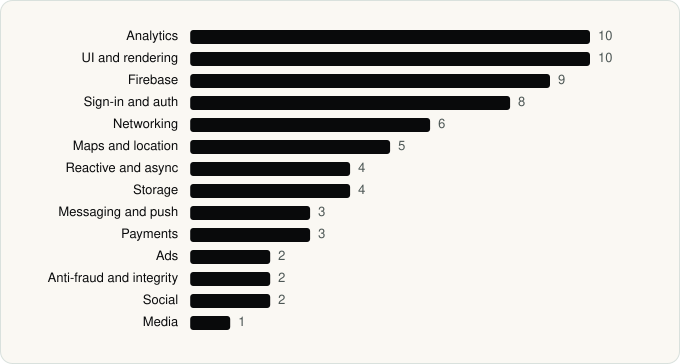

<picture><source media="(prefers-color-scheme: dark)" srcset="../assets/logo/logo-dark.svg"></picture> [Tech Stack](../README.md) / [Companies](README.md) / TikTok Pte. Ltd.

# TikTok Pte. Ltd.

The company name is the developer name on the store listing.

**2** apps (0 iOS, 2 Android) · **2** versions · **31** distinct SDKs across their latest versions

<table>
<tr><td align="center" valign="top" width="16%"> <a href="../apps/android/tiktok-pte-ltd/tiktok/README.md"><b>TikTok</b></a> Android · 31 SDKs</td><td align="center" valign="top" width="16%"> <a href="../apps/android/tiktok-pte-ltd/tiktok-pro/README.md"><b>TikTok Pro</b></a> Android · 21 SDKs</td></tr>
</table>

## Apps

| | App | Platform | Versions | Latest | Analysed | SDKs | Tracked |
|---|---|---|---|---|---|---|---|
|  | [TikTok - Videos, Shop & LIVE](../apps/android/tiktok-pte-ltd/tiktok/README.md) | Android | 1 | 45.5.1 | 2026-06-19 | 31 | Yes |
|  | [TikTok Pro - Events](../apps/android/tiktok-pte-ltd/tiktok-pro/README.md) | Android | 1 | 47.4.3 | 2026-11-01 | 21 | No |

## SDKs by category

Counted across the latest version of each app.

<picture><source media="(prefers-color-scheme: dark)" srcset="../assets/charts/companies/tiktok-pte-ltd-dark.svg"></picture>

## SDKs shared across their apps

| SDK | Apps |
|---|---|
| AppAuth | 2 of 2 |
| Cronet | 2 of 2 |
| Facebook Login | 2 of 2 |
| Facebook SDK | 2 of 2 |
| Facebook Share | 2 of 2 |
| Firebase | 2 of 2 |
| Firebase Analytics | 2 of 2 |
| Firebase Messaging | 2 of 2 |
| Fresco | 2 of 2 |
| Google App Measurement | 2 of 2 |
| Google DataTransport | 2 of 2 |
| Google Location | 2 of 2 |
| Google Maps | 2 of 2 |
| Google Play services | 2 of 2 |
| Google Sign-In / Auth | 2 of 2 |
| Markwon | 2 of 2 |
| Material Components | 2 of 2 |
| OkHttp | 2 of 2 |
| Play Integrity | 2 of 2 |
| RxJava | 2 of 2 |

---

Generated by `scripts/build_readme.py` from the JSON files. Do not edit by hand.
