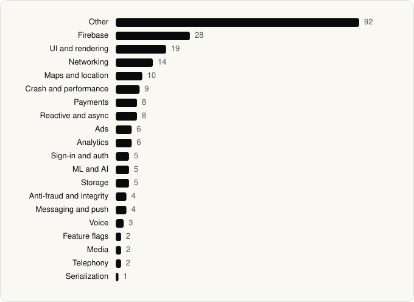

<picture><source media="(prefers-color-scheme: dark)" srcset="../assets/logo/logo-dark.svg"></picture> [Tech Stack](../README.md) / [Companies](README.md) / Uber Technologies, Inc.

# Uber Technologies, Inc.

The company name is the developer name on the store listing.

**4** apps (2 iOS, 2 Android) · **5** versions · **144** distinct SDKs across their latest versions

<table>
<tr><td align="center" valign="top" width="16%"> <a href="../apps/android/uber-technologies-inc/uber/README.md"><b>Uber</b></a> Android · 38 SDKs</td><td align="center" valign="top" width="16%"> <a href="../apps/ios/uber-technologies-inc/uber/README.md"><b>Uber</b></a> iOS · 96 SDKs</td><td align="center" valign="top" width="16%"> <a href="../apps/ios/uber-technologies-inc/uber-eats/README.md"><b>Uber Eats</b></a> iOS · 63 SDKs</td><td align="center" valign="top" width="16%"> <a href="../apps/android/uber-technologies-inc/uber-eats/README.md"><b>Uber Eats</b></a> Android · 36 SDKs</td></tr>
</table>

## Apps

| | App | Platform | Versions | Latest | Analysed | SDKs | Tracked |
|---|---|---|---|---|---|---|---|
|  | [Uber - Request a ride](../apps/android/uber-technologies-inc/uber/README.md) | Android | 1 | 4.634.10003 | 2026-06-19 | 38 | No |
|  | [Uber - Rides, Eats, Hotels](../apps/ios/uber-technologies-inc/uber/README.md) | iOS | 1 | 3.744.10001 | 2026-10-24 | 96 | No |
|  | [Uber Eats: Food & Groceries](../apps/ios/uber-technologies-inc/uber-eats/README.md) | iOS | 2 | 6.346.10000 | 2026-11-01 | 63 | No |
|  | [Uber Eats: Food and Grocery](../apps/android/uber-technologies-inc/uber-eats/README.md) | Android | 1 | 6.326.10001 | 2026-06-19 | 36 | No |

## SDKs by category

Counted across the latest version of each app.

<picture><source media="(prefers-color-scheme: dark)" srcset="../assets/charts/companies/uber-technologies-inc-dark.svg"></picture>

## SDKs shared across their apps

| SDK | Apps |
|---|---|
| Adyen | 4 of 4 |
| Braintree | 4 of 4 |
| Firebase | 4 of 4 |
| Google Mobile Ads (AdMob) | 3 of 4 |
| Lottie | 3 of 4 |
| Camera-MotionGraphics | 2 of 4 |
| Coil | 2 of 4 |
| com.uber.networking.certs | 2 of 4 |
| com.uber.networking.grpc.certs | 2 of 4 |
| Concurrent | 2 of 4 |
| Crashlytics | 2 of 4 |
| Credential Manager | 2 of 4 |
| CreditsMotionGraphics | 2 of 4 |
| Cronet | 2 of 4 |
| Cronet (Chromium net) | 2 of 4 |
| Cronet (Google) | 2 of 4 |
| DocScanMotionGraphics | 2 of 4 |
| Facebook SDK | 2 of 4 |
| FBLPromises | 2 of 4 |
| Firebase Analytics | 2 of 4 |

---

Generated by `scripts/build_readme.py` from the JSON files. Do not edit by hand.
