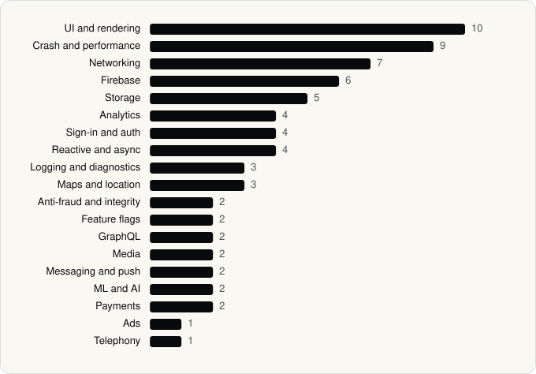

<picture><source media="(prefers-color-scheme: dark)" srcset="../assets/logo/logo-dark.svg"></picture> [Tech Stack](../README.md) / [Companies](README.md) / Wayfair, LLC

# Wayfair, LLC

The company name is the developer name on the store listing.

**2** apps (0 iOS, 2 Android) · **2** versions · **45** distinct SDKs across their latest versions

<table>
<tr><td align="center" valign="top" width="16%"> <a href="../apps/android/wayfair-llc/wayfair/README.md"><b>Wayfair</b></a> Android · 45 SDKs</td><td align="center" valign="top" width="16%"> <a href="../apps/android/wayfair-llc/wayfair-service-pro/README.md"><b>Wayfair Service Pro</b></a> Android · 26 SDKs</td></tr>
</table>

## Apps

| | App | Platform | Versions | Latest | Analysed | SDKs | Tracked |
|---|---|---|---|---|---|---|---|
|  | [Wayfair - Shop All Things Home](../apps/android/wayfair-llc/wayfair/README.md) | Android | 1 | 7.21.0 | 2026-06-19 | 45 | No |
|  | [Wayfair Service Pro](../apps/android/wayfair-llc/wayfair-service-pro/README.md) | Android | 1 | 1.100.0 | 2026-06-19 | 26 | No |

## SDKs by category

Counted across the latest version of each app.

<picture><source media="(prefers-color-scheme: dark)" srcset="../assets/charts/companies/wayfair-llc-dark.svg"></picture>

## SDKs shared across their apps

| SDK | Apps |
|---|---|
| Apollo GraphQL | 2 of 2 |
| Coil | 2 of 2 |
| Crashlytics | 2 of 2 |
| Datadog | 2 of 2 |
| DataStore | 2 of 2 |
| Firebase | 2 of 2 |
| Firebase Analytics | 2 of 2 |
| Firebase Crashlytics | 2 of 2 |
| Firebase Messaging | 2 of 2 |
| Firebase Performance | 2 of 2 |
| Firebase Remote Config | 2 of 2 |
| Fresco | 2 of 2 |
| Google App Measurement | 2 of 2 |
| Google DataTransport | 2 of 2 |
| Google Maps | 2 of 2 |
| Google Play services | 2 of 2 |
| Google Sign-In / Auth | 2 of 2 |
| Jetpack Compose | 2 of 2 |
| Kotlin Coroutines | 2 of 2 |
| Ktor | 2 of 2 |

---

Generated by `scripts/build_readme.py` from the JSON files. Do not edit by hand.
