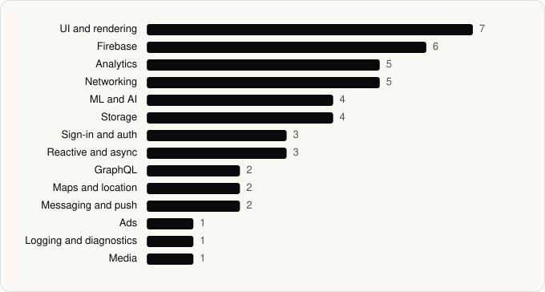

<picture><source media="(prefers-color-scheme: dark)" srcset="../assets/logo/logo-dark.svg"></picture> [Tech Stack](../README.md) / [Companies](README.md) / Wells Fargo Mobile

# Wells Fargo Mobile

The company name is the developer name on the store listing.

**2** apps (0 iOS, 2 Android) · **2** versions · **32** distinct SDKs across their latest versions

<table>
<tr><td align="center" valign="top" width="16%"> <a href="../apps/android/wells-fargo-mobile/wells-fargo-mobile/README.md"><b>Wells Fargo Mobile®</b></a> Android · 30 SDKs</td><td align="center" valign="top" width="16%"> <a href="../apps/android/wells-fargo-mobile/wells-fargo-vantage/README.md"><b>Wells Fargo Vantage®</b></a> Android · 16 SDKs</td></tr>
</table>

## Apps

| | App | Platform | Versions | Latest | Analysed | SDKs | Tracked |
|---|---|---|---|---|---|---|---|
|  | [Wells Fargo Mobile®](../apps/android/wells-fargo-mobile/wells-fargo-mobile/README.md) | Android | 1 | 26.04.02.13 | 2026-06-19 | 30 | No |
|  | [Wells Fargo Vantage®](../apps/android/wells-fargo-mobile/wells-fargo-vantage/README.md) | Android | 1 | 26.4.2.7 | 2026-06-19 | 16 | No |

## SDKs by category

Counted across the latest version of each app.

<picture><source media="(prefers-color-scheme: dark)" srcset="../assets/charts/companies/wells-fargo-mobile-dark.svg"></picture>

## SDKs shared across their apps

| SDK | Apps |
|---|---|
| Apollo GraphQL | 2 of 2 |
| Firebase | 2 of 2 |
| Firebase Analytics | 2 of 2 |
| Firebase Messaging | 2 of 2 |
| Google DataTransport | 2 of 2 |
| Google Location | 2 of 2 |
| Google Play services | 2 of 2 |
| Google Sign-In / Auth | 2 of 2 |
| Jetpack Compose | 2 of 2 |
| Material Components | 2 of 2 |
| ML Kit | 2 of 2 |
| OkHttp | 2 of 2 |
| Room | 2 of 2 |
| Volley | 2 of 2 |

---

Generated by `scripts/build_readme.py` from the JSON files. Do not edit by hand.
