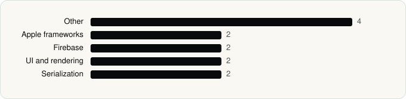

<picture><source media="(prefers-color-scheme: dark)" srcset="../assets/logo/logo-dark.svg"></picture> [Tech Stack](../README.md) / [Companies](README.md) / WhatsApp Inc.

# WhatsApp Inc.

The company name is the developer name on the store listing.

**2** apps (2 iOS, 0 Android) · **4** versions · **6** distinct SDKs across their latest versions

<table>
<tr><td align="center" valign="top" width="16%"> <a href="../apps/ios/whatsapp-inc/whatsapp-business/README.md"><b>WhatsApp Business</b></a> iOS · 6 SDKs</td><td align="center" valign="top" width="16%"> <a href="../apps/ios/whatsapp-inc/whatsapp-messenger/README.md"><b>WhatsApp Messenger</b></a> iOS · 6 SDKs</td></tr>
</table>

## Apps

| | App | Platform | Versions | Latest | Analysed | SDKs | Tracked |
|---|---|---|---|---|---|---|---|
|  | [WhatsApp Business](../apps/ios/whatsapp-inc/whatsapp-business/README.md) | iOS | 2 | 26.42.77 | 2026-11-02 | 6 | Yes |
|  | [WhatsApp Messenger](../apps/ios/whatsapp-inc/whatsapp-messenger/README.md) | iOS | 2 | 26.41.75 | 2026-10-23 | 6 | Yes |

## SDKs by category

Counted across the latest version of each app.

<picture><source media="(prefers-color-scheme: dark)" srcset="../assets/charts/companies/whatsapp-inc-dark.svg"></picture>

## SDKs shared across their apps

| SDK | Apps |
|---|---|
| CommonLibrary | 2 of 2 |
| Lottie | 2 of 2 |
| OrderedCollections | 2 of 2 |
| Promises | 2 of 2 |
| PsiphonTunnel | 2 of 2 |
| SwiftProtobuf | 2 of 2 |

---

Generated by `scripts/build_readme.py` from the JSON files. Do not edit by hand.
