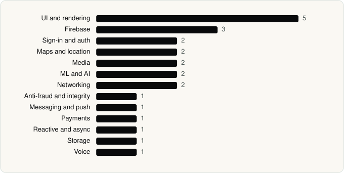

<picture><source media="(prefers-color-scheme: dark)" srcset="../assets/logo/logo-dark.svg"></picture> [Tech Stack](../README.md) / [Companies](README.md) / WhatsApp LLC

# WhatsApp LLC

The company name is the developer name on the store listing.

**2** apps (0 iOS, 2 Android) · **3** versions · **25** distinct SDKs across their latest versions

<table>
<tr><td align="center" valign="top" width="16%"> <a href="../apps/android/whatsapp-llc/whatsapp-business/README.md"><b>WhatsApp Business</b></a> Android · 25 SDKs</td><td align="center" valign="top" width="16%"> <a href="../apps/android/whatsapp-llc/whatsapp-messenger/README.md"><b>WhatsApp Messenger</b></a> Android · 24 SDKs</td></tr>
</table>

## Apps

| | App | Platform | Versions | Latest | Analysed | SDKs | Tracked |
|---|---|---|---|---|---|---|---|
|  | [WhatsApp Business](../apps/android/whatsapp-llc/whatsapp-business/README.md) | Android | 1 | 2.26.44.74 | 2026-11-13 | 25 | No |
|  | [WhatsApp Messenger](../apps/android/whatsapp-llc/whatsapp-messenger/README.md) | Android | 2 | 2.26.41.77 | 2026-10-23 | 24 | No |

## SDKs by category

Counted across the latest version of each app.

<picture><source media="(prefers-color-scheme: dark)" srcset="../assets/charts/companies/whatsapp-llc-dark.svg"></picture>

## SDKs shared across their apps

| SDK | Apps |
|---|---|
| AndroidSVG | 2 of 2 |
| Credential Manager | 2 of 2 |
| Cronet | 2 of 2 |
| Cronet (Google) | 2 of 2 |
| ExoPlayer | 2 of 2 |
| Firebase | 2 of 2 |
| Firebase Messaging | 2 of 2 |
| Fresco | 2 of 2 |
| Google DataTransport | 2 of 2 |
| Google Location | 2 of 2 |
| Google Maps | 2 of 2 |
| Google Play Billing | 2 of 2 |
| Google Play services | 2 of 2 |
| Google Sign-In / Auth | 2 of 2 |
| Jetpack Compose | 2 of 2 |
| Kotlin Coroutines | 2 of 2 |
| Lottie | 2 of 2 |
| Material Components | 2 of 2 |
| Media3 (ExoPlayer) | 2 of 2 |
| ML Kit | 2 of 2 |

---

Generated by `scripts/build_readme.py` from the JSON files. Do not edit by hand.
