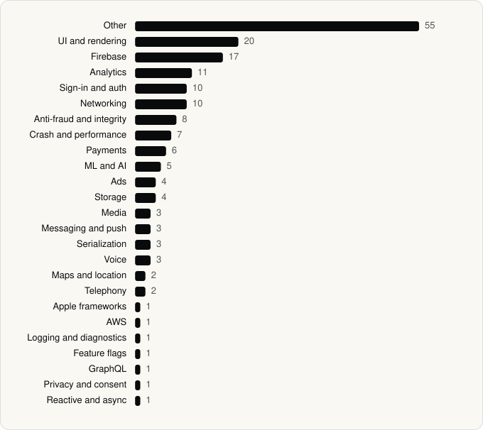

<picture><source media="(prefers-color-scheme: dark)" srcset="../assets/logo/logo-dark.svg"></picture> [Tech Stack](../README.md) / [Companies](README.md) / X Corp.

# X Corp.

The company name is the developer name on the store listing.

**4** apps (3 iOS, 1 Android) · **16** versions · **160** distinct SDKs across their latest versions

<table>
<tr><td align="center" valign="top" width="16%"> <a href="../apps/ios/x-corp/grok/README.md"><b>Grok</b></a> iOS · 47 SDKs</td><td align="center" valign="top" width="16%"> <a href="../apps/ios/x-corp/grok-bot/README.md"><b>Grok Bot</b></a> iOS · 18 SDKs</td><td align="center" valign="top" width="16%"> <a href="../apps/android/x-corp/x/README.md"><b>X</b></a> Android · 50 SDKs</td><td align="center" valign="top" width="16%"> <a href="../apps/ios/x-corp/x/README.md"><b>X</b></a> iOS · 65 SDKs</td></tr>
</table>

## Apps

| | App | Platform | Versions | Latest | Analysed | SDKs | Tracked |
|---|---|---|---|---|---|---|---|
|  | [Grok - AI Chat & Video](../apps/ios/x-corp/grok/README.md) | iOS | 13 | 1.4.58 | 2026-10-24 | 47 | Yes |
|  | [Grok Bot](../apps/ios/x-corp/grok-bot/README.md) | iOS | 1 | 1.0.0 | 2026-08-11 | 18 | Yes |
|  | [X](../apps/android/x-corp/x/README.md) | Android | 1 | 12.36.1-prod.01 | 2026-10-24 | 50 | No |
|  | [X](../apps/ios/x-corp/x/README.md) | iOS | 1 | 11.97 | 2026-06-23 | 65 | No |

## SDKs by category

Counted across the latest version of each app.

<picture><source media="(prefers-color-scheme: dark)" srcset="../assets/charts/companies/x-corp-dark.svg"></picture>

## SDKs shared across their apps

| SDK | Apps |
|---|---|
| Sentry | 3 of 4 |
| AppAuth | 2 of 4 |
| BrazeKit | 2 of 4 |
| CastleSDK | 2 of 4 |
| FBLPromises | 2 of 4 |
| Firebase | 2 of 4 |
| Google Mobile Ads (AdMob) | 2 of 4 |
| GoogleSignIn | 2 of 4 |
| GoogleUtilities | 2 of 4 |
| GTMAppAuth | 2 of 4 |
| GTMSessionFetcher | 2 of 4 |
| Highlight.js | 2 of 4 |
| LinkKit | 2 of 4 |
| Lottie | 2 of 4 |
| MarkdownView | 2 of 4 |
| MathJax | 2 of 4 |
| nanopb | 2 of 4 |
| SwiftProtobuf | 2 of 4 |
| WebRTC | 2 of 4 |

---

Generated by `scripts/build_readme.py` from the JSON files. Do not edit by hand.
