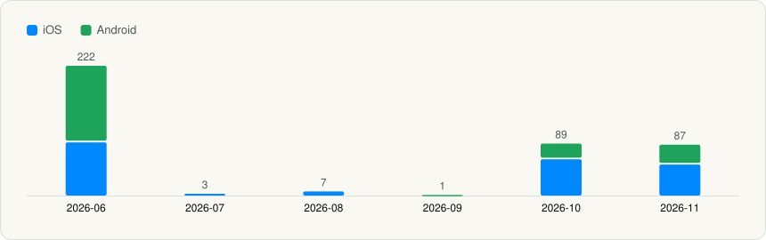

# Data notes

How the data is collected and what each field means. Back to the [README](../README.md).

## Method

Each app version is a public store build that was downloaded and read with static analysis: the binary is
inspected for languages, frameworks, SDKs, platform targets, capabilities and privacy declarations.

## Notes

- **Public store builds only.** Every version passes a public-store filter (`isPublicStoreVersion`).
  Pre-release channels and non-store builds are never exported. `public_store_build` is always `true`.
- **`captured_at` is when the analysis was published**, not when the binary was downloaded and not the
  store release date. `store_first_seen_at` is when the version was first seen on the store and
  `store_updated_at` is the store's own update date, when known. `exported_at` is when the file was written
  here. All times are UTC (ISO 8601, `Z`).
- **SDK lists are a floor** when `confidence.sdk_list_is_floor` is true: static analysis finds what it can
  recognise, so absence of an SDK does not prove it is not used. `binary_encrypted` (App Store FairPlay) and
  `packed` / `packers` (Android packers) mark builds where less was visible.
- **SDK confidence**: `observed` = matched directly in the binary; `inferred` = derived indirectly (for
  example from mined strings); `unknown` = older analyses without a per-item match level.
- **`inferred[]` is model-written.** Headlines and insights were written by a language model from the
  detected signals and are labelled with their method. Treat them as commentary, not measurement.
- **Inactive apps** (`app.active: false`) are no longer tracked. Their history stays here.
- **Companies** use the developer name on the store listing, exactly as shown there: the iTunes Lookup
  `artistName` for iOS (the developer shown under the app name; it can differ from the "Seller") and the
  Google Play listing's developer for Android. A store can spell a company differently per platform, and
  that spelling is kept. `data/company-sources.csv` holds the live-checked name and its source for every
  app; it overrides the source record on every export and regenerate. Names are never guessed: an app with
  no verified company is left out, and the build fails on any blank or placeholder company.
- **App icons** come from the public store listings (iTunes Lookup `artworkUrl512` for iOS, the Google
  Play listing for Android), cached at 128 px and given the same rounded corners. Each icon's source is
  kept in `data/icon-sources.csv`. An app without a verified icon is left out instead of showing a
  placeholder.
- **Not exported, by design:** network hosts and endpoints, backend and GraphQL details, certificates,
  cloud project ids, SDK config keys, on-device data and database layouts, feature flags, signing details,
  tracking domain names (only their count), and any account, key or console data.

Every icon also comes from the store listing. Versions captured per month:

<picture><source media="(prefers-color-scheme: dark)" srcset="../assets/charts/captured-by-month-dark.svg"></picture>
